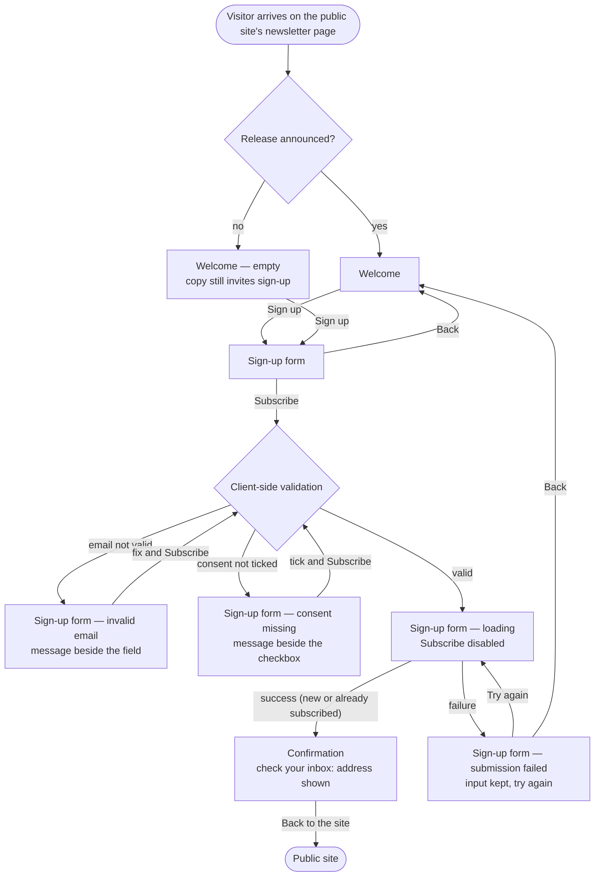

# Structure — Newsletter sign-up journey

Three screens, no account: **Welcome → Sign-up form → Confirmation**. Every screen works on desktop and on a phone: it fits the width with no horizontal scrolling, and every control is large enough to tap (AC 6).

## Personas

| Persona | Who (source) | Needs | Pain points |
|---|---|---|---|
| **First-time visitor** (main persona) | A visitor to the public site who wants to hear about new releases without creating an account (story, PRD §1) | Know what they are signing up for (new releases, at most once a month); sign up with just an email address and an explicit consent; get clear feedback if something is wrong; know what happens next (check the inbox) | Today the only way to hear about releases is to create an account, which most visitors do not want; may be on a phone |
| **Returning visitor** | A visitor who signed up before and comes back to the page (PRD §1, §4 edge cases) | Can go through the same journey again without trouble | Must not be told whether their address is already on the list. They get the same Confirmation as anyone else, so the page reveals nothing about who has signed up |

## User interaction

## Screen inventory

| Screen | Purpose | Main elements | States |
|---|---|---|---|
| **Welcome** | Explain what the newsletter is and invite the visitor in (FR1) | Heading; short copy: new releases, at most once a month; no account needed; one primary action, **Sign up** | **Default**: copy can mention the latest release. **Empty**: no release announced yet, so the copy talks about future releases and still invites the sign-up. Loading: n/a. Error: n/a |
| **Sign-up form** | Collect an email address and an explicit consent, then submit (FR2–FR5) | Email field with a visible label; consent checkbox, unticked by default, with the full wording beside it: "Send me the product newsletter. I can unsubscribe at any time."; primary action **Subscribe**; **Back** link to Welcome; an error message slot beside each control; a form-level message area | **Default**: empty field, checkbox unticked. **Error: invalid email**: text beside the field says what is wrong; the form stays on screen (AC 2). **Error: consent missing**: text beside the checkbox asks for the consent (AC 3). **Loading**: a progress indicator on Subscribe; Subscribe cannot be pressed again (AC 4). **Error: submission failed**: a message that the sign-up did not go through; email and checkbox keep what the visitor entered; a way to **try again** (AC 5). Empty: n/a |
| **Confirmation** | Tell the visitor what happens next (FR6) | Heading; "Check your inbox to confirm"; the email address the mail went to; **Back to the site** link | **Default**: the only state. A returning visitor gets the identical screen, which never says whether the address was already on the list. Loading / error / empty: n/a |

## Open branches

I set a default for each of these so the journey is complete. Please confirm or change them.

1. **When validation runs.** Default: the checks run when the visitor presses Subscribe (FR3 says "before it submits"), and a message clears as soon as its control is fixed. Should the email also be checked when the visitor leaves the field?
2. **Both errors at once.** Default: if the email is invalid *and* the consent is unticked, both messages show together, each beside its own control. Focus moves to the first problem. The diagram shows them as two states only to keep it readable.
3. **"Try again" after a failure.** Default: the failure message sits above the form, and pressing **Subscribe** again is the retry; there is no separate Retry button. Do you want a dedicated "Try again" button in the message instead?
4. **Back from the form.** Default: going back to Welcome and returning to the form keeps what the visitor typed in the same session. Should it clear instead?
5. **"Back to the site" destination.** Default: the public site's home page. Does it link somewhere else, such as the release notes?
