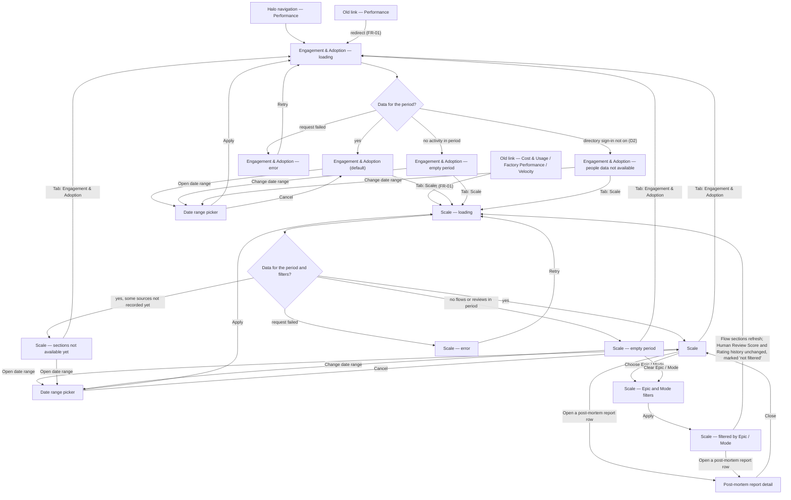

# HALO-100 — Structure: the user journey for the new Performance tabs

Story: HALO-100 (design of the **Engagement & Adoption** and **Scale** Performance tabs).
Sources: Epic PRD v3 (§3 to-be process, §4 FR-01–FR-05, FR-10–FR-15, FR-20–FR-33, FR-44, §7 decisions), User Story Backlog v1 (HALO-102 … HALO-110 acceptance criteria).
Out of scope for this journey (AC 4): the "Full dashboard" tab (D11), any people/team administration page, the "Underwriting users vs Everyone" filter (D14), data export.

## Personas

| Persona | Who (source) | Needs | Pain points today |
| --- | --- | --- | --- |
| **Rollout sponsor** (primary) | Harel and McKinsey stakeholders who sponsor and steer the Halo rollout; the prototype was prepared for named leadership reviewers (PRD §1). | See whether Halo is being used, by whom and how much it produces (active users per week, per team, per person; lines of code; stories funnel; stories per week). See whether the factory is good, fast and cheap enough to scale (human review score, factory quality, delivery quality, AI judge, flow completion, time to converge, cost). Every headline figure compared with the previous period of the same length. Decide where to push adoption (e.g. the Underwriting team that started 15 Nov) and where the factory needs work. | Today's three tabs (Cost & Usage, Factory Performance, Velocity) are built around factory internals — flows, steps, tokens — not leadership's questions. "Compare to previous period" is always empty. Numbers have to be pulled by hand by the engineering team. Halo does not know who was active or which team they belong to. |
| **Halo team member** (secondary) | The Halo team, who use the same pages to spot problem flows (PRD §1). | Find problem flows: unfinished flows and the last step they reached, the most expensive flows, post-mortem reports (what went well / wrong / change next time), AI judge agreement with people. Trust that cost, quality, delivery and time figures equal what the old tabs showed (FR-50). | Detail only the old tabs showed (tokens by type, spend by step, models with no price, per-story chat drill-down) is dropped (R6, A6). Post-mortem dimension scores, judge time per run and critique-led revisions are not recorded yet, so parts of Scale will be empty for a while (R7, FR-28). |

Context that shapes both personas:

- Everyone who can open Performance sees all per-person data; no extra permission (D12, FR-44) — so there is no "permission denied" branch.
- Team is McKinsey or Internal, set automatically from the sign-in email; it is read-only everywhere (D3, HALO-102 AC 4).
- Small numbers (about a dozen users, ~a month of data, R5) and no history before sign-in went live (R2): empty and "no earlier data" states will be common in the first weeks and must look intentional, not broken.

## User interaction

Reading notes:

- `Date range picker` is one shared filter-bar control (PRD §3); it is drawn twice only so each tab's return path is visible. Applying it reloads the tab you are on.
- `Scale — sections not available yet` is the normal Scale page where some sections show "not available yet" because their source is not recorded yet (post-mortem dimensions and reports FR-23/24, judge time per run, agreement with post-mortem and critique-led revisions FR-28). It is a state of `Scale`, listed separately because it will be the common case at launch.
- Sorting the Flows cost table by a column (FR-33) and hovering charts happen in place on `Scale` / `Engagement & Adoption`; they do not leave the screen.

## Screen inventory

| Screen | Purpose | Main elements (top to bottom, PRD §3 order) | States |
| --- | --- | --- | --- |
| **Halo navigation — Performance** | The way in to Performance from Halo's existing navigation. | Existing Performance entry; opens the default tab. | Default only (existing Halo chrome). |
| **Old link — Performance** | Keep bookmarked Performance links working (FR-01). | No UI of its own — lands on Engagement & Adoption. | Default (redirect). |
| **Old link — Cost & Usage / Factory Performance / Velocity** | Keep links to the removed tabs working (FR-01; HALO-105/106/107 AC 4). | No UI of its own — lands on Scale. | Default (redirect). |
| **Engagement & Adoption — loading** | Show the tab is fetching the period's figures. | Tab bar with **Engagement & Adoption** selected and **Scale**; filter bar with Date range only (D13); section skeletons in final order. | Loading. |
| **Engagement & Adoption (default)** | Answer "is Halo used, by whom, and how much does it produce?" (FR-10–FR-15). | 1. Tab bar (exactly two tabs, FR-01). 2. Filter bar: Date range only. 3. **Active users** — headline (all teams) with change vs previous period; weekly trend chart (active users per Sun–Thu week). 4. **Active users by team** — secondary table, per week: McKinsey, Internal, All teams (FR-11). 5. **Adoption by person** — one row per active person: name, team (read-only), active days "n / working days", stories opened, completed, merged, lines of code merged (FR-12). 6. **Lines of code** — headline lines merged and lines per active user, each with change and a weekly chart (FR-13). 7. **Stories funnel** — Opened → Completed → Merged with each stage's count and conversion %, e.g. 10 → 6 (60%) → 5 (83%) (FR-14). 8. **Stories per week** — average of full weeks, total in period, weekly chart with partial weeks marked (FR-15). Every chart names its axes; partial edge weeks are labelled (FR-04). | Default; headline figure in each of the 3 states (see conventions below); a single section with no data shows a dash / "not available yet" while the rest renders. |
| **Engagement & Adoption — error** | Tell the user the figures could not be loaded and let them retry. | Tab bar and filter bar stay usable; error message in place of sections; **Retry**. | Error. |
| **Engagement & Adoption — empty period** | The selected range has no activity at all (common early on, R2). | Sections in order, every headline a dash with "not available yet", charts with empty axes, tables with an empty-row message; prompt to change the date range. | Empty. |
| **Engagement & Adoption — people data not available** | Directory sign-in is off in this environment, so people-based figures cannot be counted (D2, backlog wave 0). | Active users, Active users by team and Adoption by person show "not available" with the reason (sign-in not on); Lines of code, Stories funnel and Stories per week still render; lines per active user shows a dash. | Not available (partial). |
| **Date range picker** | Set the period every figure and the previous-period comparison use (FR-02, FR-03). | Start and end date; **Apply**, **Cancel**. Shared by both tabs. | Default; invalid range (end before start) blocks Apply. |
| **Scale — loading** | Show Scale is fetching. | Tab bar with **Scale** selected; filter bar: Date range, Epic, Mode (FR-02); section skeletons in final order. | Loading. |
| **Scale** | Answer "is the factory good, fast and cheap enough to scale?" (FR-20–FR-33). | 1. Tab bar. 2. Filter bar: Date range, Epic, Mode. 3. **Filters note** — which sections follow Epic/Mode and which do not. 4. Side by side: **Human Review Score** — 1–5 coloured gauge, average, "n reviews", "n reviewers", change; labelled "not filtered by Epic or Mode" (FR-20, D4) · **Factory quality score** (0–3) — overall, Definition, Delivery; "n scored by a person, n by the post-mortem"; plain note naming flows with no post-mortem yet, e.g. epic intake (FR-22, FR-25, D5); **post-mortem score by dimension** charts — Definition: Convergence, Interaction, Integration; Delivery: Convergence, Feedback integration, Scope discipline (FR-23); **post-mortem reports** list — flow, type, finished date, score, newest first, rows openable (FR-24). 5. **Rating history** — weekly average with period-average line; **Individual reviews** table: date, reviewer, team, rating, feedback, newest first; reviews from before sign-in show a dash for reviewer and team; labelled "not filtered" (FR-21). 6. **Delivery quality** — first-pass CI green rate, review clean on first push, fix attempts per MR, MR count; weekly chart of the two rates; weekly chart of fix attempts (FR-26). 7. **AI judge as a factory step** — judge runs, judge cost (noted as included in total cost), runs by step, agreement with the human score + weekly agreement chart (FR-27); extra measures: avg time per run, agreement with post-mortem, share of critiques that led to a revision (FR-28). 8. **Flow completion** — completion %, "completed / started", weekly completion-rate chart, note that flows started today are left out (FR-29); **Unfinished flows** list — flow, person, team, start date, last step reached (FR-30). 9. **Time to converge** (completed flows) — average time, longest story with flow, person and date, average turns, distribution by 1-hour bands, weekly averages of time and turns (FR-31). 10. **Cost** — total, per completed flow, per line of code, weekly charts of total cost and cost per line (FR-32); **Flows cost table** — flow id, story title, cost, date, person, team, status; sorted by cost desc, every column header sortable; cost-distribution chart in $1 bands (FR-33). | Default; headline figure in each of the 3 states; Flows cost table re-sorted by a chosen column; a section with no data shows dash / "not available yet". |
| **Scale — sections not available yet** | The launch-time reality: some sources are not recorded yet (dependencies §5, R7). | Same as Scale; post-mortem dimensions, post-mortem reports, judge time per run, agreement with post-mortem and critique-led revisions each show a dash with "not available yet" — never 0 and never the judge score as a substitute (FR-05, FR-25). | Not available (partial). |
| **Scale — error** | Figures could not be loaded; let the user retry. | Tab bar and filter bar stay usable; error message; **Retry**. | Error. |
| **Scale — empty period** | No flows and no reviews in the period (or under the chosen Epic/Mode). | Sections in order with dash / "not available yet", empty chart axes and empty-table messages; prompts to change the date range or clear Epic/Mode. | Empty. |
| **Scale — Epic and Mode filters** | Narrow the flow-based sections to one epic and/or mode (FR-02). | Epic selector (all epics or one); Mode selector (all / simple / advanced); **Apply**. | Default; selected. |
| **Scale — filtered by Epic / Mode** | Show the filtered page so it is clear what changed and what did not (HALO-104 AC 4). | Active filter values visible in the filter bar with a way to clear; flow-based sections refreshed; Human Review Score and Rating history unchanged and still labelled "not filtered by Epic or Mode". | Default; leads to loading / empty like Scale. |
| **Post-mortem report detail** | Read why a finished Definition or Delivery got its score (FR-24). | Flow, type, finished date, score; **What went well**, **What went wrong**, **What to change next time**; **Close**. | Default; not reachable while reports are "not available yet". |

State conventions used on both tabs (AC 2, AC 3; FR-03–FR-05):

| Element | States to design |
| --- | --- |
| Headline figure | (a) value + change vs previous period of equal length (up / down / no change); (b) value + "no earlier data to compare"; (c) dash + "not available yet". Never a made-up 0. |
| Weekly chart | Sun–Thu weeks; both axes named; partial weeks at either edge of the period marked "partial"; empty state with axes and a "not available yet" note. |
| Table | Rows; empty-table message; dash in a cell that cannot be known (e.g. reviewer before sign-in). |

## Open branches

1. **Default date range and presets.** The sources never say what range Performance opens with or whether presets exist. Simplest choice: keep the date-range control and default the current Performance tabs already use. Should the new tabs offer presets (e.g. last 7 / 30 days, this month)?
2. **What carries over when switching tabs.** Simplest choice: the date range is shared and kept when you switch tabs. Epic and Mode stay set on Scale but are hidden on Engagement & Adoption (D13), so they are still applied when you come back to Scale. Should filters also live in the URL so a link someone shares opens with the same view?
3. **Redirect from old links.** Simplest choice: redirect silently to the top of the new tab. Should a one-time notice explain where the old tab went (e.g. "Cost & Usage is now part of Scale"), or should the redirect jump to the matching section (Cost, Delivery quality, Time to converge)?
4. **How a post-mortem report opens.** Simplest choice: the row expands in place. The alternative is a side panel or dialog. Which one fits Halo's current look?
5. **Error scope.** Simplest choice: one error state per tab, as in the diagram. Scale draws on several reports, though. Should one failed source show an error card only in its section while the rest of the page renders?
6. **Navigating a long Scale page.** Scale has 8 stacked sections. Simplest choice: no in-page navigation, matching the prototype's top-to-bottom reading. Do you want a section index or sticky section headers?
7. **Rows linking out.** The sources do not say whether a flow id, story title or person in the tables (Unfinished flows, Flows cost table, Adoption by person) opens the story. Simplest choice: plain text, no links.
8. **Long tables.** With about a dozen users (R5), the simplest choice is to show every row with no pagination. Should the Flows cost table and Individual reviews have a row limit with "show more" as data grows?
9. **Transition period.** The backlog adds the new tabs beside the old ones and removes each old tab only in the story that replaces it. Simplest choice: design only the final two-tab state and let the interim tab bar follow from it. Do you also want the interim tab bar designed?
