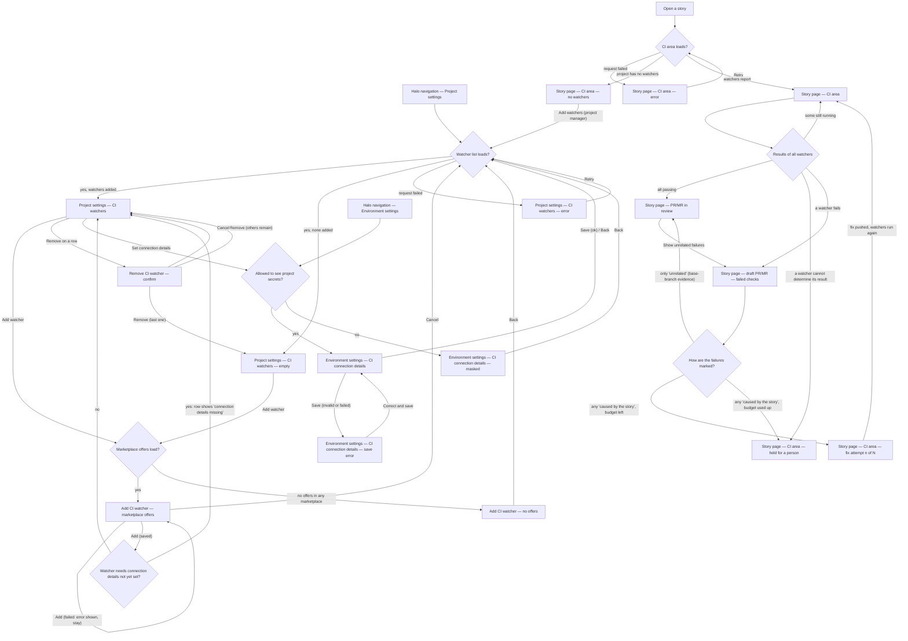

# HALO-112 — Structure: the user journey for CI watchers

Story: HALO-112 (design of the CI watcher flows). Epic HALO-111, "move CI integration to skill".
Traces to: FR-1, FR-3, FR-6, FR-8, FR-9, FR-11, FR-12 · target process steps 3, 6, 7, 8.
Sources: the story text and its acceptance criteria (AC 1–5). The epic PRD is referenced only by link and its content was not available to this step, so nothing below goes beyond what the story states.

Three flows, as the story asks:

1. **Settings** — add and remove CI watchers offered by the marketplaces (default, project, custom); connection details live in environment settings (AC 2).
2. **Story page, CI area** — name and result per watcher, fix attempts out of the budget, hold for a person (AC 3).
3. **Draft PR/MR** — failed checks with their reason, marked "caused by the story" (נגרם מהסיפור) or "unrelated" (לא קשור) with evidence from the base branch; the PR/MR moves to review when only unrelated failures remain (AC 4).

Scope rules that shape every screen (AC 5):

- Access details (secrets) are shown **masked** to anyone not allowed to see the project's secrets.
- There is **no** screen, toggle or setting for built-in GitHub/GitLab watching. If today's settings show one, the rebuilt screen drops it.
- Building the screens is out of scope; this story designs them.

## Personas

| Persona | Who (source) | Needs | Pain points |
| --- | --- | --- | --- |
| **Project manager** (sets up) | "A project manager who adds CI watchers" (story). | See which watchers the marketplaces offer, grouped by source: default, project, custom. Add a watcher, see the list of added watchers, remove one. Enter each watcher's connection details in environment settings. | CI watching is moving from a built-in GitHub/GitLab integration to watchers delivered as skills (epic HALO-111). Without an agreed design, the settings screens would be improvised (story "so that"). |
| **Product manager / developer** (reads results) | "A product manager or developer who reads their result on the story page" (story). | For each watcher on the story: its name and result (passing, failing, still running, cannot be determined). How many fix attempts were made, out of the budget. When the story is held for a person: why, and by which watcher. For a draft PR/MR: which checks failed and why, and whether each failure was caused by the story or is unrelated, with the base-branch evidence. Know when the PR/MR moved to review. | A PR/MR can stay in draft because of failures. Without a per-check mark and evidence, the reader cannot tell a failure the story caused from one already failing on the base branch. |
| **Project member without access to project secrets** (variant) | AC 5: "anyone not allowed to see the project's secrets". | Open environment settings and see that connection details exist, without seeing their values. | — (a permission boundary, not a request from this user). |

## User interaction

## Screen inventory

`based on` uses the checkout directory `test-repo-for-halo-7ad879b52d`. That checkout is the spec repository only: it holds no Halo product code. So every screen that exists in Halo today (project settings, environment settings, the story page) is `not found` until the designer attaches a screenshot.

| Screen | Purpose | Main elements | States (default / loading / error / empty) | Based on |
| --- | --- | --- | --- | --- |
| **Halo navigation — Project settings** | Entry to the watcher settings. | Settings entry in Halo navigation. | Default. | not found |
| **Project settings — CI watchers** | See and manage the watchers added to the project (AC 2). | Section title; list of added watchers: name, source marketplace (default / project / custom), connection status ("connected" / "connection details missing" with **Set connection details**), **Remove**; **Add watcher**. No built-in GitHub/GitLab toggle (AC 5). | Default; loading (list skeleton). Error and empty are their own rows below. | not found (project settings page; the CI watchers section is new) |
| **Project settings — CI watchers — empty** | Say no watcher is added yet and lead to adding one. | Empty message; **Add watcher**. | Empty. | not found (same page) |
| **Project settings — CI watchers — error** | The list failed to load. | Error message; **Retry**. | Error. | not found (same page) |
| **Add CI watcher — marketplace offers** | Pick a watcher the marketplaces offer and add it (AC 2). | Offers grouped by source: **Default marketplace**, **Project marketplace**, **Custom marketplace**; per offer: name, short description, "already added" mark; **Add**; **Cancel**. | Default; loading (offers load); adding (button busy); error (offers failed → Retry; add failed → message, stay on screen). Empty is its own row. | new |
| **Add CI watcher — no offers** | No marketplace offers a watcher. | Empty message; **Back**. | Empty. | new |
| **Remove CI watcher — confirm** | Confirm removing a watcher (AC 2). | Watcher name; what removal means (it no longer reports on stories); **Remove**; **Cancel**. | Default; removing (busy); error (removal failed → message, stay). | new |
| **Halo navigation — Environment settings** | Direct entry to environment settings. | Settings entry in Halo navigation. | Default. | not found |
| **Environment settings — CI connection details** | Enter and change each watcher's connection details (AC 2). | One group per added watcher: its connection fields; secret fields masked by default with show/replace; **Save**; **Back**. | Default; loading; saving; empty (no watchers added → link to Project settings — CI watchers). Error is its own row. | not found (environment settings page; the CI group is new) |
| **Environment settings — CI connection details — masked** | Same page for someone not allowed to see project secrets (AC 5). | Same groups and field names; every secret value masked, no show control; note that secrets are hidden for their role. | Default (read-only); loading. | not found (same page) |
| **Environment settings — CI connection details — save error** | Saving failed or a value is invalid. | Field-level messages; page-level message for a failed save; entered values kept. | Error. | not found (same page) |
| **Open a story** | Entry to the story page. | Story in the cockpit list. | Default. | not found |
| **Story page — CI area** | Show each watcher's result on the story (AC 3). | Per watcher: name and result — **passing**, **failing**, **still running**, **cannot be determined**; fix attempts "n of N" (budget); link to the PR/MR. | Default; loading (area skeleton); "still running" (some results pending). Error and no watchers are their own rows. | not found (story page; the CI area is new or rebuilt) |
| **Story page — CI area — error** | The CI area failed to load; the rest of the story page still works. | Error message in the area; **Retry**. | Error. | not found (story page) |
| **Story page — CI area — no watchers** | The project has no CI watchers, so nothing reports. | Empty message; link to Project settings — CI watchers (shown to project managers). | Empty. | not found (story page) |
| **Story page — CI area — fix attempt n of N** | Show that a fix attempt is under way and how much budget is left (AC 3). | Attempt counter "n of N"; which watcher's failure is being fixed; watcher results stay visible. | Default; budget nearly used (last attempt). | not found (story page) |
| **Story page — CI area — held for a person** | Show that the story waits for a person, why and because of which watcher (AC 3). | Hold banner: **reason** (e.g. fix budget used up; result cannot be determined); **watcher** name; attempts "N of N"; link to the PR/MR. | Default. | not found (story page) |
| **Story page — draft PR/MR — failed checks** | Explain why the PR/MR stays in draft (AC 4). | "Draft" status; list of failed checks: check name, watcher, failure reason, mark **caused by the story** (נגרם מהסיפור) or **unrelated** (לא קשור); for "unrelated", the evidence from the base branch (the same check failing there, with a link); link to the PR/MR. | Default; marking in progress (check not yet marked). | not found (story page; this section is new) |
| **Story page — PR/MR in review** | Show that the PR/MR left draft and went to review (AC 4). | "In review" status; when present, the remaining failures, all marked **unrelated**, with their evidence (**Show unrelated failures**); link to the PR/MR. | Default (no failures); with unrelated failures only. | not found (story page) |

## Open branches

1. **Screenshots of today's screens.** The only checkout is the spec repository, so today's Project settings, Environment settings and Story page could not be found. Please attach screenshots of them, especially any current CI section or built-in GitHub/GitLab toggle. Without them those rows stay `not found` and the next steps design the new sections against a generic page.
2. **Who may add and remove watchers.** The story names the project manager. Simplest choice: only project managers see **Add watcher** and **Remove**; everyone else sees the list read-only. Is that right?
3. **Watcher added without connection details.** Simplest choice (in the diagram): the watcher is added at once and its row shows "connection details missing" with a link to environment settings. The alternative is to send the user straight to environment settings after **Add**.
4. **Where the failure marks appear.** Simplest choice: on the story page only. Should the failed checks, their marks and the base-branch evidence also be posted as a comment on the PR/MR in GitHub/GitLab?
5. **"Cannot be determined".** The story lists it as a result but does not say what follows. Simplest choice (in the diagram): the story is held for a person, with that reason. The alternative is to keep waiting and show the result without a hold.
6. **What the person does on a hold.** The story asks only to show the reason and the watcher. Simplest choice: no action in Halo, only a link to the PR/MR. Should the hold offer actions (e.g. try again, accept a failure as unrelated)?
7. **Replacing secrets without seeing them.** Simplest choice: someone not allowed to see project secrets gets a read-only masked page. Should they still be able to replace a value without seeing it?
8. **Removed watcher on a running story.** Simplest choice: past results stay on the story page, labelled "watcher removed". Confirm, or should they disappear?
