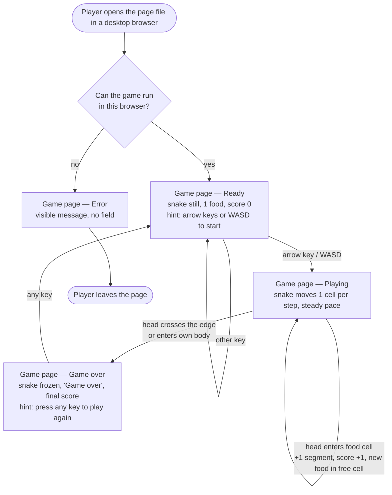

# Structure — Minimal Snake game journey (HALO-118)

One page, one screen: **Game page**. The journey runs through four states of that screen: **Ready → Playing → Game over → Ready**, plus **Error** when the game cannot start (AC 1). The player uses only the keyboard on a desktop browser. The page has no buttons, menus or touch controls (AC 3, D-2, D-3).

## Personas

| Persona | Who (source) | Needs | Pain points |
|---|---|---|---|
| **Player** (main persona) | Anyone who opens the page in a current desktop browser and plays with the keyboard (PRD "Users", HALO-119) | Play straight away with no install, account or setup (FR-1). See the field, snake, food and score at a glance (FR-2). Know which keys start the game and how to play again (FR-3, FR-7). See the final score when the round ends (FR-6) | A blank or frozen page with no explanation if the browser cannot run the game (FR-8, D-5). Distraction from anything beyond the bare game (FR-2, D-3) |
| **Epic product owner** (approver of this design, not a player) | The story's requester, who approves the look before HALO-119 builds it (HALO-118 user story) | All four states shown so the game is built once (AC 1). A look that is clearly minimal (AC 2). Nothing out of scope on screen (AC 3) | Rework after the build if a state or message was never designed |

## User interaction

## Screen inventory

| Screen | Purpose | Main elements | States |
|---|---|---|---|
| **Game page** | The single screen of the game: show the round and the player's progress through it (FR-1, FR-2, FR-6, FR-7, FR-8) | **Score line** above the field: "Score: N". **Play field**: a square grid with a plain border; the snake as solid cells in one colour, its head may be a shade darker; one food cell in a second colour. **Message line** below the field, for short hints and the end-of-round message. Plain colours only; no images, icons, sound, buttons or decoration (AC 2, AC 3) | **Default — Ready**: snake at its starting length (3) and position, still; one food item; "Score: 0"; message line: "Press an arrow key or WASD to start". **Default — Playing**: field, snake, food and score line only; message line empty (AC 2). **Game over**: snake frozen where it crashed; message line: "Game over — final score N. Press any key to play again"; score line keeps the final score. **Error**: no play field; one visible message in its place, e.g. "The game could not start in this browser. Try a current version of Chrome, Firefox, Edge or Safari." (FR-8). **Loading**: n/a, the page is self-contained and starts at once. **Empty**: n/a, a round always has a snake and one food item |

## Open branches

I set a default for each of these so the journey is complete. Please confirm or change them.

1. **Key that restarts after Game over.** Default: *any* key starts a new round in the **Ready** state (score 0, starting snake, one food), and the next arrow/WASD key starts the movement. This avoids a stray key throwing the player straight into motion. Alternative: an arrow/WASD key restarts and starts moving in that direction in a single press.
2. **Where the Game over message sits.** Default: in the message line below the field, with the frozen snake still visible on the field. Alternative: a plain text box centred over the field.
3. **Error message wording.** Default: the text in the inventory above. It names no technical cause. Should it name the cause (for example "JavaScript is turned off") when the page can tell?
4. **Grid size and colours.** Default: a 20 × 20 grid on a light background, dark snake, one contrasting food colour, and a dark text score line. The final values are set in the screen design, not here.
5. **Window loses focus during play.** The sources rule out pause (D-3), so the default is that the snake keeps moving when the player switches tabs, and the round can end without them watching. Confirm that this is acceptable.
