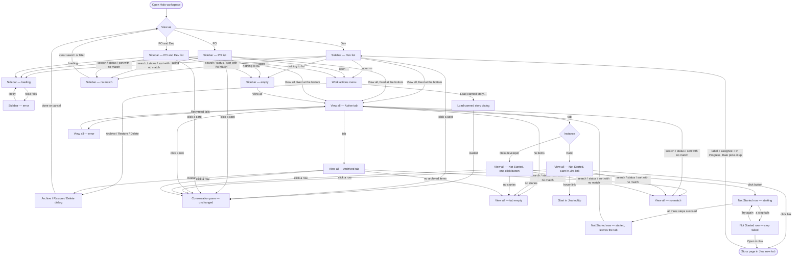

# HALO-121 — User journey: role-based sidebar, View all page, wide card

Scope: the sidebar list (**My Work**) per "View as" choice, the wider sidebar card, the fixed **View all** button, and the **View all** page with its Active, Not Started and Archived tabs, including the "Start in Jira" link (Harel instance) and the one-click button (Halo-developer instance). The conversation pane, its approvals and the steps of a started story are not changed. The journey only shows where users enter and leave them.

Today (frontend `harel-pdlc-frontend-539650d6a7`):

- The list lives in `src/halo/workspace/Workspace.tsx` (`WorkspacePanel`).
- It splits into a **Backlog** section (`BacklogSection.tsx`) and an **Active sprint** section (`ActiveSprintSection.tsx`, with epic group heads and a "No epic" group).
- The "⋯" **Work actions** menu holds:
  - Show archived;
  - Show unassigned issues and Show backlog issues;
  - Archive, Restore and Delete;
  - Load canned story….
- The sidebar is `--panel-w: 288px` (`src/index.css`).
- A row puts the title, type badge and status tag on one top line, with `TICKET · STORY` below. This is why titles are cut.

## Personas

| Persona | View as | Needs (from the sources) | Pain points today |
| --- | --- | --- | --- |
| **Developer** | Dev | See only the started stories assigned to them, in one flat list (FR-5). Find their Not Started stories and start them in Jira (FR-11, FR-12). | Stories are split under Active sprint epic groups and hidden behind the Show unassigned / Show backlog toggles. Titles are cut after a few words. Stories can be started by mistake from inside Halo. |
| **Product owner** | PO | See their epics, which are the project's non-archived epics (FR-6). Reach archived items to restore or delete them (FR-14). Approve the design (this story). | A "Backlog" header over a narrow list. Archived items are only reachable through a "Show archived" toggle in "⋯". |
| **PO and developer** | PO and Dev | See epics with each epic's stories indented beneath them, with epic and story rows clearly told apart (FR-7). | Two half-height sections (Backlog / Active sprint) that list the same epics twice. |
| **Halo developer** (a developer on a non-Harel instance) | Dev or PO and Dev | Start a Not Started story in one click, without going to Jira (FR-13). Still load and start the canned story (FR-2). | Three separate actions in Jira to start a story. |

The **Harel instance vs. Halo-developer instance** difference is a per-deployment setting (HALO-123), not a persona. It only changes the end of a Not Started row: a link or a button.

## User interaction

## Screen inventory

| Screen | Purpose | Main elements | States (default / loading / error / empty) | Based on |
| --- | --- | --- | --- | --- |
| Sidebar — Dev list | Show a developer the started stories assigned to them (FR-4, FR-5). | **My Work** header, + New Epic (reserved in Dev today), ⋯, Search, Status filter, Sort. One flat list of **wide story cards** with no epic group bar, no "Active sprint" header and no sprint name. **View all** pinned under the list. Wider sidebar (FR-16). | Default: the list. Loading, error, empty, no match: see their own rows. | `harel-pdlc-frontend-539650d6a7/src/halo/workspace/Workspace.tsx` (`WorkspacePanel`) + `harel-pdlc-frontend-539650d6a7/src/halo/workspace/ActiveSprintSection.tsx` (`StoryRow`) |
| Sidebar — PO list | Show a PO the project's non-archived epics (FR-6). | Same header and controls. A flat list of **wide epic cards** with no "Backlog" header. **View all** pinned. | As above. | `harel-pdlc-frontend-539650d6a7/src/halo/workspace/Workspace.tsx` + `harel-pdlc-frontend-539650d6a7/src/halo/workspace/BacklogSection.tsx` |
| Sidebar — PO and Dev list | Show epics with their stories indented beneath them (FR-7). | One list with no section headers. An **epic card** with epic shading, then its story cards indented with a different shading. **View all** pinned. | As above. An epic with no listed stories still shows (it is in progress). | `harel-pdlc-frontend-539650d6a7/src/halo/workspace/Workspace.tsx` + `BacklogSection.tsx` + `ActiveSprintSection.tsx` (merged into one list) |
| *Wide card (part of the three lists)* | A readable title (FR-16, FR-17). | Row 1: the full-width title (RTL-aware, `textDirection`). Row 2: the ticket ref and STORY/EPIC on the leading side, and the status tags ("Need you", "DESIGN", type badge, "Archived") in the **bottom-right corner**. Row ⋯ on hover. Selected / picked / archived treatments. | Default, selected, picked, hover with ⋯. | `harel-pdlc-frontend-539650d6a7/src/halo/workspace/ActiveSprintSection.tsx` (`StoryRow`), `BacklogSection.tsx` (epic row), `WorkspaceSections.css` |
| Sidebar — loading | The summary is being read. | Skeleton rows. **View all** stays pinned. | Loading. | `harel-pdlc-frontend-539650d6a7/src/halo/workspace/Workspace.tsx` (`halo-workspace-panel__loading`) |
| Sidebar — error | The summary read failed. | Error message with **Retry**. | Error. | `harel-pdlc-frontend-539650d6a7/src/halo/workspace/Workspace.tsx` (`halo-workspace-panel__error`) |
| Sidebar — empty | Nothing to list in this view, for example a developer with no started story. | Per-view empty message (see Open branches). **View all** stays as the way to Not Started. | Empty. | `harel-pdlc-frontend-539650d6a7/src/halo/workspace/ActiveSprintSection.tsx` / `BacklogSection.tsx` (`halo-workspace-section__empty`) |
| Sidebar — no match | Search or status filter matches nothing (FR-18). | "No matching stories" / "No matching epics". | Empty (filtered). | `harel-pdlc-frontend-539650d6a7/src/halo/workspace/Workspace.tsx` (`emptyMessage` when `filtering`) |
| Work actions menu | The list's ⋯ without the "Show ..." items (FR-15). | Archive, Restore, Delete (to a caller with epic.remove, on the pick or the open item) and Load canned story… (dev). **Removed:** Show archived, Show unassigned issues, Show backlog issues. The "Show N unassigned / backlog" hint under the list is removed too. | Default. Items disabled when nothing applies (as today). | `harel-pdlc-frontend-539650d6a7/src/halo/workspace/Workspace.tsx` (`PaneActionsMenu` "Work actions") + `harel-pdlc-frontend-539650d6a7/src/halo/workspace/conversation/PaneActionsMenu.tsx` |
| Archive / Restore / Delete dialog | Confirm a batch archive, restore or delete (unchanged). | Item list, confirm, cancel. | As today. | `harel-pdlc-frontend-539650d6a7/src/halo/workspace/EpicBatchDialog.tsx` |
| Load canned story dialog | Dev-only load of the canned story (unchanged, FR-2 exception). | As today. | As today. | `harel-pdlc-frontend-539650d6a7/src/halo/workspace/conversation/LoadCannedStoryDialog.tsx` |
| Conversation pane — unchanged | Where a clicked card or row opens. Out of scope: shown only as the destination. | As today. | As today. | `harel-pdlc-frontend-539650d6a7/src/halo/workspace/conversation/WorkspaceConversation.tsx` |
| View all — Active tab | Every in-progress epic and started story of the project, not only the current user's (FR-9, FR-10). | Main-panel page title "View all". Tabs: **Active · Not Started · Archived**, each with a count. Search, Status filter and Sort for the page. Rows: title, ticket ref, type (epic/story), parent epic for stories, assignee, status tag. | Default: rows. Loading: skeleton rows. Error: see its own row. Empty: see its own row. | `new` (rows reuse the wide card's tags) |
| View all — Not Started, Start in Jira link | Stories assigned to me that lack AI-Factory or are not In Progress, on the Harel instance (FR-11, FR-12). | Same tabs and controls. A row shows: title, ticket ref, parent epic, Jira status, and a "missing" hint (no AI-Factory label / not In Progress). At the row end: a **Start in Jira** link with an external-link icon. | Default, loading, error, empty. | `new` |
| Start in Jira tooltip | Say how to start a story in Jira (FR-12). | Exact text: "To start a story in Jira, add the AI-Factory label, assign it to yourself, and move it to In Progress". Shown on hover and on keyboard focus. | Shown / hidden. | `harel-pdlc-frontend-539650d6a7/src/halo/ui/HaloTooltip.tsx` (the primitive; the content is new) |
| View all — Not Started, one-click button | Same list on a Halo-developer instance (FR-13). | Same row. At the row end: a **Start** button in place of the link. | Default, loading, error, empty. | `new` |
| Not Started row — starting | The button's three Jira steps are running. | Button busy ("Starting…"), row stays in place. | Loading. | `new` |
| Not Started row — started, leaves the tab | All three steps succeeded. The story now meets the start condition and leaves Not Started. | Short confirmation, then the row leaves the tab. The story then appears in Active and in the developer's sidebar once Halo starts it. | Success. | `new` |
| Not Started row — step failed | One or more steps failed (FR-13, HALO-126 scenario 3). | An inline message on the row that names each step: label ✓/✗, assignee ✓/✗, In Progress ✓/✗. Buttons: **Try again** and **Open in Jira**. | Error. | `new` |
| Story page in Jira | External. The developer adds the label, assigns the story and moves it to In Progress. | Jira's own page, opened in a new tab. | — | `not found` (external system, not a Halo screen) |
| View all — Archived tab | Archived epics and stories, the same set "Show archived" reveals today (FR-14). | Same tabs and controls. Archived rows, dimmed, with an "Archived" tag. Pick and row ⋯ with **Restore** and **Delete** (to a caller with epic.remove). | Default, loading, error, empty. | `new` page. Rows and actions from `harel-pdlc-frontend-539650d6a7/src/halo/workspace/BacklogSection.tsx` / `ActiveSprintSection.tsx` (archived treatment) and `harel-pdlc-frontend-539650d6a7/src/halo/workspace/batchRowActions.ts` |
| View all — tab empty | A tab has nothing to list. | Per-tab message: "No epics or stories in progress", "No stories waiting for you to start", "No archived items". | Empty. | `new` |
| View all — no match | Search or status filter matches nothing in the current tab (FR-18). | "No matching items" and a way to clear the search or filter. | Empty (filtered). | `new` |
| View all — error | The page's data read failed. On Not Started this includes a failed Jira read. | Error message with **Retry**. | Error. | `new` |

## Open branches

I chose an answer for each of these so the journey is complete, but each one is the designer's call:

1. **Which stories go under an epic in the PO and Dev list?**
   - My choice: all of the epic's non-archived stories, started or not, assigned to anyone.
   - Why: the PRD's "Dropped role view" risk says unassigned and out-of-sprint stories stay reachable "through their epic in the combined view".
   - The alternative: only the started stories assigned to me, as in the Dev list.
2. **Q1: does the developer's flat list keep merged, non-archived stories?**
   - My choice: no. Only started stories still in progress (the backlog's working assumption).
3. **Search, status and sort on View all.**
   - My choice: the page has its own Search, Status and Sort, shared across its three tabs (FR-18, HALO-125 scenario 9). The sidebar's own controls do not drive the page.
4. **What happens right after the button succeeds?**
   - My choice: the row shows a short "Started in Jira" confirmation, then leaves Not Started at once.
   - The open question: should a "Waiting for Halo to start it" note show until the story appears in Active? This answers the "changes in Jira are seen late" risk.
5. **Empty-state copy.**
   - Dev sidebar with no started story: "No started stories assigned to you. See View all → Not Started."
   - PO sidebar: "No epics yet".
   - Not Started on a project with no Jira board: "Stories can be started only from Jira. This project has no Jira board."
   - Please confirm or replace these.
6. **Is View all a selectable place?**
   - My choice: while the page is open, the **View all** button looks selected and no sidebar card is highlighted.
   - Clicking a row in any tab leaves the page for that item's conversation pane. The browser's back button returns to the same tab.
