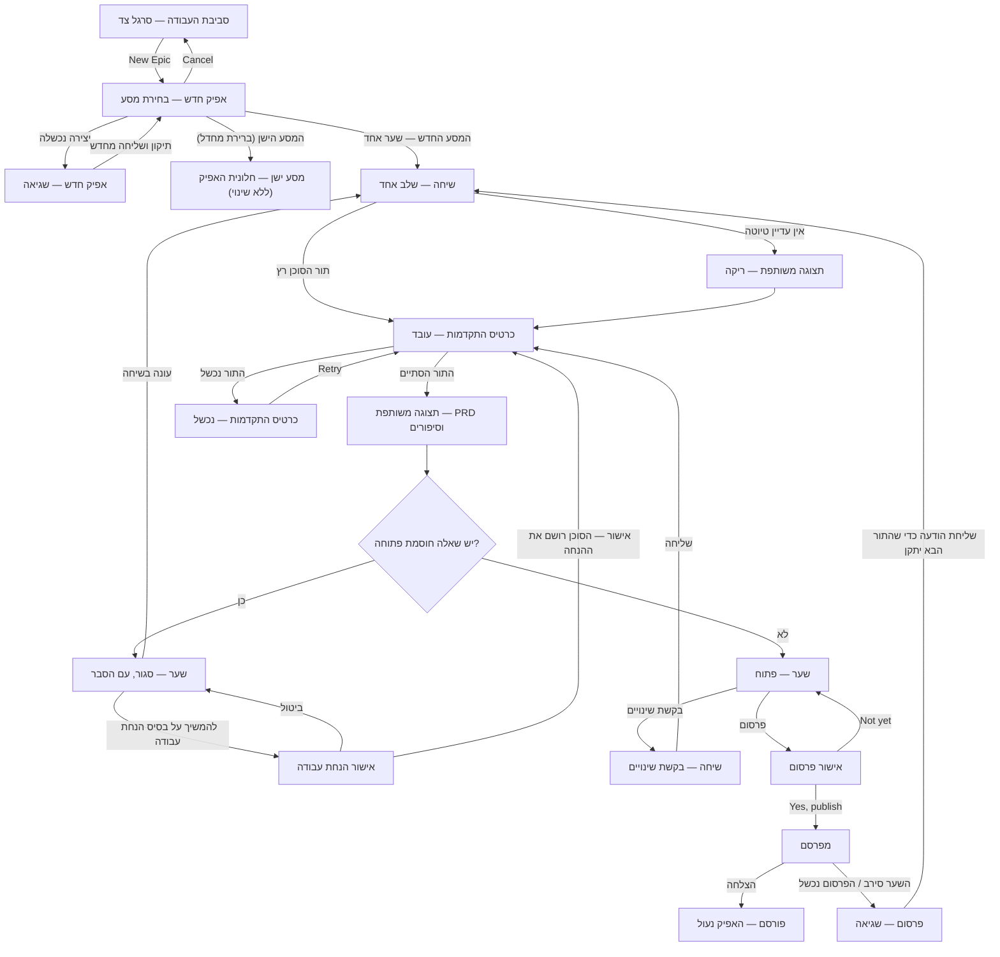

# HALO-142 — מבנה: מסע מנהל המוצר בשער אחד

עוקב אחר R1, R2, R3, R5, R17 · סיכון RK4 · אפיק HALO-141.
המסע הישן (שלושה שלבים: Epic specification → Epic break down → Publish stories, ושני שערי אישור) נשאר כמו שהוא ואינו חלק מהעיצוב. העיצוב מראה רק איך מגיעים אליו.

## Personas

| פרסונה | מה צריך | מה מכאיב היום | מקור |
|---|---|---|---|
| **מנהל מוצר שפותח אפיק ב-Halo** | לבחור את המסע כשהוא פותח את האפיק; לראות שלב אחד בלבד; לסקור את מסמך הדרישות ואת הסיפורים במקום אחד; לסיים בשער אחד, "פרסום" או "בקשת שינויים"; להבין בלי הסבר מה מצופה ממנו בכל רגע. | המסע היום עובר בשלושה שלבים ובשני שערים: אישור ה-PRD, אישור הסיפורים, ואחר כך פרסום. מסמך הדרישות ועמוד הסיפורים מופיעים ככרטיסים נפרדים שנפתחים ב-Confluence. כשנשארה שאלה חוסמת, השער סגור ומוצגת רק הסיבה, בלי דרך להמשיך על בסיס הנחת עבודה. | הסיפור HALO-142; `harel-pdlc-backend-e936d14678/docs/workflows/v2/product-owner-journey.md` (Scope, The publish gate); `harel-pdlc-frontend-539650d6a7/src/halo/workspace/conversation/WorkspaceConversation.tsx` (כרטיסי האישור) |

מי שאין לו הרשאה לאשר (`mayApprove` שקרי, או אפיק לקריאה בלבד) אינו פרסונה נפרדת. הוא מופיע כמצב "קריאה בלבד" של השער, כמו בקוד היום.

## User interaction

## Screen inventory

נתיבי המקור מתחילים בשם תיקיית ה-checkout מהרשימה. ‏`WC.tsx` מקצר את `harel-pdlc-frontend-539650d6a7/src/halo/workspace/conversation/WorkspaceConversation.tsx`.

| מסך | מטרה | רכיבים עיקריים | מצבים (ברירת מחדל / טעינה / שגיאה / ריק) | based on |
|---|---|---|---|---|
| סביבת העבודה — סרגל צד | נקודת הכניסה: משם פותחים אפיק חדש | כפתור New Epic, רשימת האפיקים של המשתמש | ברירת מחדל: הרשימה · טעינה: הרשימה נטענת · שגיאה: הודעה ו-Retry · ריק: "No epics of yours yet". New Epic נעול עד שיש פרויקט | `harel-pdlc-frontend-539650d6a7/src/halo/sidebar/HaloSidebar.tsx` |
| אפיק חדש — בחירת מסע | פתיחת אפיק ובחירת המסע | שם, תיאור, מסמכי ייחוס, Confluence pills; **חדש:** בורר מסע עם שתי אפשרויות, "המסע הישן" (מסומן כברירת מחדל, לפי הנחת העבודה של Q7) ו"המסע החדש — שער אחד", ולכל אחת שורה אחת שמתארת אותה; Create epic, Cancel | ברירת מחדל: המסע הישן מסומן · טעינה: "Creating…" והשדות נעולים · שגיאה: ראו השורה הבאה · ריק: Create epic נעול עד שיש שם | `harel-pdlc-frontend-539650d6a7/src/halo/workspace/NewEpicPage.tsx` |
| אפיק חדש — שגיאה | הבקשה נכשלה, והטיוטה ובחירת המסע נשמרות | שגיאת ה-API מתחת לתיבה, מזהה הבקשה | שגיאה בלבד | `harel-pdlc-frontend-539650d6a7/src/halo/workspace/NewEpicPage.tsx` |
| מסע ישן — חלונית האפיק (ללא שינוי) | גבול התחום: מי שבחר במסע הישן מגיע אליו כמו היום | פס שלושת השלבים, שני כרטיסי אישור וכרטיס פרסום, בלי שינוי | כמו היום, ללא עיצוב חדש | `harel-pdlc-frontend-539650d6a7/src/halo/workspace/conversation/WorkspaceConversation.tsx` (`EpicPane`, `EpicThread`) |
| שיחה — שלב אחד | השיחה עם הסוכן, ופס שלבים שמציג שלב אחד בלבד | כותרת האפיק, פס שלבים עם שלב יחיד, הודעת הפתיחה עם מסמכי הייחוס, הודעות, Composer | ברירת מחדל: השרשור · טעינה: השרשור נטען · שגיאה: שליחת הודעה נכשלה ("Message not sent — …"), והטקסט והקבצים נשמרים · ריק: "No messages yet. The agent will post the first draft shortly." | `WC.tsx` (`EpicPane`, `StepsBar`, `EpicThread`, `Composer`) |
| כרטיס התקדמות — עובד | מראה מה הסוכן עושה עכשיו, בשלב היחיד | שם השלב, תתי-שלבים (מחקר, PRD, סיפורים), תצוגה חיה של המסמך, Stop | ברירת מחדל: רץ · טעינה: ממתין לתור הראשון · שגיאה: ראו השורה הבאה · ריק: אין | `harel-pdlc-frontend-539650d6a7/src/halo/workspace/conversation/EpicWorkCard.tsx`, `harel-pdlc-frontend-539650d6a7/src/halo/workspace/conversation/StepSubsteps.tsx` |
| כרטיס התקדמות — נכשל | התור נכשל או נעצר, ומוצגת הדרך להמשיך | הסיבה, Retry | שגיאה בלבד | `harel-pdlc-frontend-539650d6a7/src/halo/workspace/conversation/EpicWorkCard.tsx` (`EpicRunCard`) |
| תצוגה משותפת — PRD וסיפורים | מסמך הדרישות והסיפורים במקום אחד, לסקירה לפני השער | שתי לשוניות או שני קטעים, "מסמך דרישות" ו"סיפורים", עם מספר הסיפורים; גרסת העמוד ומצב הסנכרון; פתיחה ב-Confluence | ברירת מחדל: שני המסמכים · טעינה: המסמך נטען · שגיאה: "not synced" או עמוד שלא נקרא, עם הסבר · ריק: ראו השורה הבאה | `WC.tsx` (`ArtifactsPanel`: כרטיסי PRD ו-Stories), `harel-pdlc-frontend-539650d6a7/src/halo/workspace/conversation/PlanDocuments.tsx` (`DocumentFolds`). התצוגה המשותפת עצמה חדשה |
| תצוגה משותפת — ריקה | לפני הטיוטה הראשונה | שורה שאומרת שהסוכן כותב את הטיוטה | ריק בלבד | `WC.tsx` (`ArtifactsPanel`) |
| שער — פתוח | השער היחיד: "פרסום" או "בקשת שינויים" | כותרת, משפט שאומר מה הפרסום עושה (יוצר את האפיק והסיפורים ב-Jira ונועל את האפיק), כפתורי "פרסום" ו"בקשת שינויים" | ברירת מחדל: שני הכפתורים · טעינה: כרטיס השער לא מוצג בזמן שתור רץ · שגיאה: ראו "פרסום — שגיאה" · ריק: אין. במצב קריאה בלבד מוצג טקסט בלי כפתורים | `WC.tsx` (כרטיס `approval-publish`, `RequestChangesButton`) |
| שער — סגור, עם הסבר | יש שאלה חוסמת פתוחה, ולכן "פרסום" סגור | "פרסום" מנוטרל; הסבר שמונה את השאלות החוסמות; הפעולה "להמשיך על בסיס הנחת עבודה"; הפניה לענות בשיחה | ברירת מחדל: סגור עם הסבר · שאר המצבים: אין | `WC.tsx` (`is-blocked`, `prdApprovalBlockedReason`). הפעולה "להמשיך על בסיס הנחת עבודה" חדשה |
| אישור הנחת עבודה | מנהל המוצר מורה להמשיך על בסיס הנחות העבודה של השאלות הפתוחות | רשימת השאלות, ולצד כל אחת הנחת העבודה שהסוכן הציע; "אישור", "ביטול" | ברירת מחדל · טעינה: "שולח…" · שגיאה: השליחה נכשלה, והחלון נשאר פתוח | new |
| שיחה — בקשת שינויים | "בקשת שינויים" ממקדת את ה-Composer, עם placeholder שאומר מה לכתוב | Composer ממוקד, placeholder, צירוף קבצים | ברירת מחדל · טעינה: שולח · שגיאה: "Message not sent — …" · ריק: שליחה נעולה כל עוד אין טקסט | `WC.tsx` (`Composer`, `onRequestChanges`) |
| אישור פרסום | עצירה לפני פעולה שאי אפשר לבטל | "Publish N stories and lock the epic?", ‏"Yes, publish", ‏"Not yet" | ברירת מחדל בלבד | `WC.tsx` (`confirmPublish`) |
| מפרסם | הפרסום רץ | "Publishing the stories", ספינר, משפט שאומר מה נכתב ל-Jira | טעינה בלבד | `WC.tsx` (`publishInFlight`) |
| פורסם — האפיק נעול | הסוף: האפיק נעול, והסיפורים קיימים ב-Jira | כרטיסי האפיק והסיפורים ב-Jira, השיחה לקריאה בלבד | ברירת מחדל בלבד | `WC.tsx` (`ArtifactsPanel`: `storyCards`, `publishCards`), `StepClosedBar` |
| פרסום — שגיאה | השער סירב (409) או שהפרסום נכשל | הסיבה, כפי שהשרת ניסח אותה, והדרך הלאה (לשלוח הודעה כדי שהתור הבא יכתוב את העמוד מחדש) | שגיאה בלבד | `WC.tsx` (`publishError`, `publishBlockedReason`) |

## Open branches

לפי זיכרון המוצר `agents-decide-without-asking`, אף אחת מההכרעות למטה לא נשלחת כשאלה. בכל אחת אימצתי את ההמלצה שלי, והיא רשומה כאן כדי שהמעצב יוכל לשנות אותה.

1. **Q7: איזה מסע מסומן כברירת מחדל.** *הוחלט:* המסע הישן, לפי הנחת העבודה בסיפור. מנהל המוצר בוחר במסע החדש במפורש. אם Q7 תוכרע אחרת, משנים רק את הבחירה ההתחלתית בבורר, והזרימה נשארת כמו שהיא.
2. **אחרי "להמשיך על בסיס הנחת עבודה": פתיחה ישירה של השער, או תור של הסוכן קודם.** *הוחלט:* תור של הסוכן. הוא רושם את ההנחות במסמך הדרישות, ואז השער נפתח. כך המסמך שמתפרסם אומר על מה הוא מבוסס, כמו שהסיפור הזה עצמו רושם את הנחת העבודה של Q7. פתיחה ישירה הייתה חוסכת תור, אבל משאירה את השאלות פתוחות במסמך.
3. **שער אחד מאחד שלושה מעברים: אישור ה-PRD, אישור הסיפורים והפרסום.** *הוחלט:* "פרסום" מוביל ישר לאישור פרסום אחד, "Publish N stories and lock the epic?", ואין אישור ביניים. זה הפשוט ביותר שעדיין עוצר לפני פעולה שאי אפשר לבטל.
4. **צורת התצוגה המשותפת.** *הוחלט:* שתי לשוניות בפאנל המסמכים, "מסמך דרישות" ו"סיפורים", והפתיחה ב-Confluence נשארת. המעצב יכול לבחור במקומן שני קטעים זה מתחת לזה, והזרימה לא תשתנה.
5. **האם אפשר להחליף מסע אחרי שהאפיק נוצר.** *הוחלט:* לא. הבחירה נעשית רק במסך "אפיק חדש", והסיפור והמקורות אינם מזכירים החלפה.
