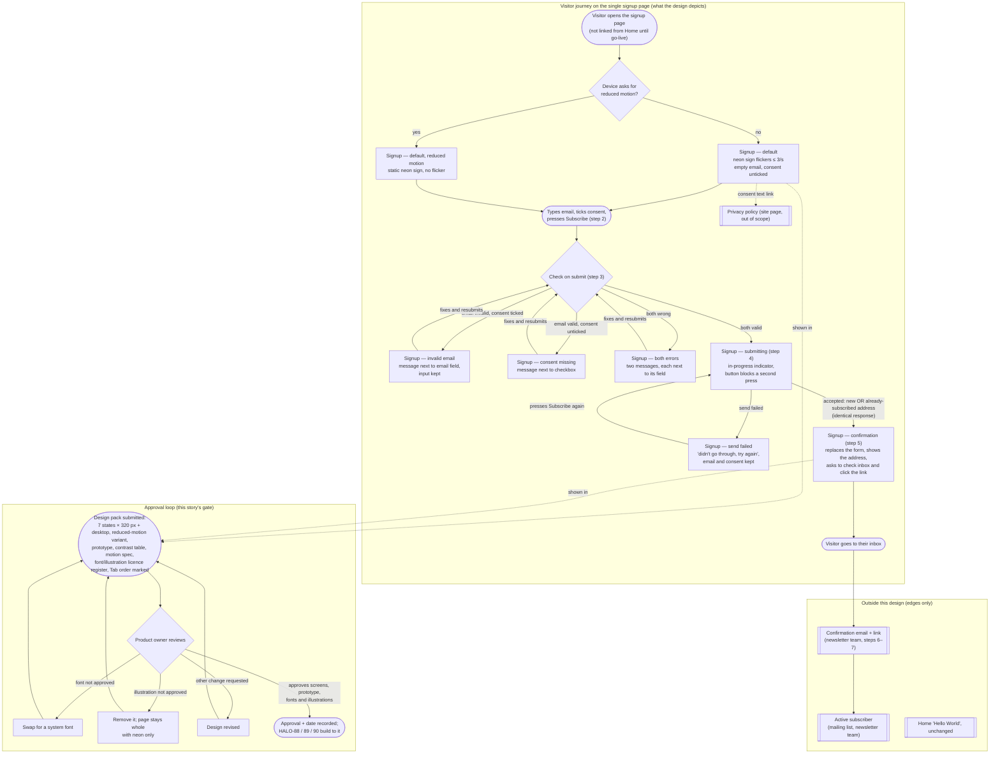

# Structure — Neon Nights Weekly signup journey (HALO-87)

One new page, **Neon Nights Weekly signup**: a 1980s rock-and-pop neon page (dark background, a neon-sign heading in pink, turquoise and purple) where a music fan types an email address, ticks an unticked consent box and subscribes. Every state of the form (default, errors, submitting, failure, confirmation) happens **on that same page**, with no navigation to other pages (R1). This story designs **seven form states × two widths (phone 320 px and desktop)**, a **static reduced-motion variant** of the default screen, a clickable prototype, a colour/contrast table and a font/illustration licence register. It ends when the product owner (Ophir) approves them and the approval date is recorded (AC 1–6). HALO-88, HALO-89 and HALO-90 then build to it.

The existing "Hello World" home page, the confirmation email and the mailing list belong to other owners and are **out of scope** (PRD §8). They appear below only to mark the edges of the journey. The neutral three-screen signup design already on the site is **not** used as a base or as inspiration (PRD §7).

## Personas

| Persona | Who (source) | Needs | Pain points |
|---|---|---|---|
| **Product owner: design approver** (story persona) | Ophir, owner of "Neon Nights Weekly". Approves the look, the fonts and the illustrations before anything is built (story; PRD §5) | Every form state in both widths, plus a clickable prototype covering the happy path and each error (AC 1). A contrast ratio listed for every text/background pair, including error text and the focus ring (AC 3). A flicker spec of ≤ 3 flashes/s and a static variant (AC 4). Source and licence next to every font and illustration, so each one can be approved or dropped (AC 5). The approval and its date recorded next to the design (AC 6) | Neon on dark backgrounds can hurt readability (RK1). A font or illustration that resembles a real artist, album cover or lyric creates rights exposure (RK3). Wants the page built once, without rounds of fixes (story) |
| **Music fan visiting the site** (the person the design is for) | Visitor who wants a weekly rock & pop newsletter, without an account (PRD §1.2, §7; HALO-88, HALO-89) | See at once what the newsletter is and how often it arrives (R18). Subscribe in seconds. A clear message next to the field when something is missing, with the typed input kept (R4, R5). Know the submission went through and that they must check their inbox (R7). Use the page on a phone, with the keyboard only, or with reduced motion (R12–R14) | Unreadable neon or fast flicker, which can trigger seizures in sensitive people (RK1, RK2). Losing what they typed after an error or a failed send (R8). Sound that plays by itself (R15). Not understanding what they are signing up for (RK7). A page that reveals whether an address is already subscribed (RK6) |

## User interaction

Visitor states are shown with the PRD flow step numbers (§3). Each screen node is designed at **320 px and desktop**.

## Screen inventory

All screens are one page (R1): no site navigation, no audio player (R15). Shared on every form screen: neon-sign heading "Neon Nights Weekly"; the blurb (music, hits and stories from rock & pop, once a week; R18); an email field with a visible label (R2); an unticked consent checkbox with the full working consent text, including the right to unsubscribe at any time (R3); a privacy-policy link next to the consent text (R17); a Subscribe button. Tab order is email → consent → button, with a visible focus ring (R13). Every control has a hit area of at least 44×44 px, with no horizontal scroll at 320 px (R14). Illustrations (big hair, big clothes) are optional decoration and never sit in the Tab order (R11; HALO-90).

| Screen | Purpose | Main elements | States (default / loading / error / empty) |
|---|---|---|---|
| **Signup — default** | First impression; start signing up (step 1–2) | Shared elements; flickering neon heading (≤ 3 flashes/s, R12); optional illustrations | **Default / empty:** email empty, consent unticked, no messages. Loading: n/a. Error: n/a |
| **Signup — default, reduced motion** | Same as default for visitors whose device asks for reduced motion (AC 4) | Identical to default; neon heading fully static | Default / empty only; no animation anywhere on the page |
| **Signup — invalid email** | Say what is wrong with the address and send nothing (R4) | Shared elements; inline message under the email field saying the address is invalid and what a valid one looks like (e.g. `fan@example.com`); field marked invalid by more than colour alone; typed text and consent kept | **Error.** Clears back to default when the visitor resubmits with a valid address |
| **Signup — consent missing** | Ask for the box to be ticked and send nothing (R5) | Shared elements; inline message next to the checkbox asking to tick it; email kept | **Error** |
| **Signup — both errors** | Show both problems at once (PRD §3 exceptions) | Both inline messages, each next to its own field | **Error** (two messages) |
| **Signup — submitting** | Show the send is in progress and block double submit (R6) | Shared elements, filled in; button shows an in-progress label/indicator and does not send again; inputs not editable while sending | **Loading** |
| **Signup — send failed** | Say the signup didn't go through and allow a retry (R8) | Shared elements; failure message near the button ("didn't go through, try again"); email and consent kept; Subscribe enabled for retry | **Error** (system). Retry goes back to *submitting* |
| **Signup — confirmation** | Confirm receipt and tell the visitor to check their inbox (R7). Identical for a new and an already-subscribed address (R9) | Neon heading; the form is replaced by a message that shows the typed address (long addresses wrap at 320 px) and asks the visitor to check their inbox and click the link; no unsubscribe or list management (PRD §8) | **Default** (single success state; same copy and look for every accepted address) |

## Open branches

1. **When does validation run?** The ACs trigger messages on Subscribe, but HALO-88's story text says "immediately". Proposed default: validate on submit only, and clear each message once that field is fixed on the next submit. Should messages also appear when the visitor leaves a field (on blur)?
2. **Focus after errors and after confirmation.** Keyboard and screen-reader users need to know something changed. Proposed default: on errors, focus moves to the first invalid field. On confirmation, focus moves to the confirmation message. Approve, or prefer an error summary at the top?
3. **Privacy-policy link while the address is unknown.** R1 forbids site navigation, but R17 needs this link and the approved URL is still to come (PRD §5). Proposed default: the link opens in a new tab, so the typed form stays intact, and it points to a placeholder until go-live. OK?
4. **Way back from confirmation.** The sources give the visitor no "use a different address" action. Proposed default: none; the confirmation is final for this visit. Confirm that no "change address" link is wanted.
