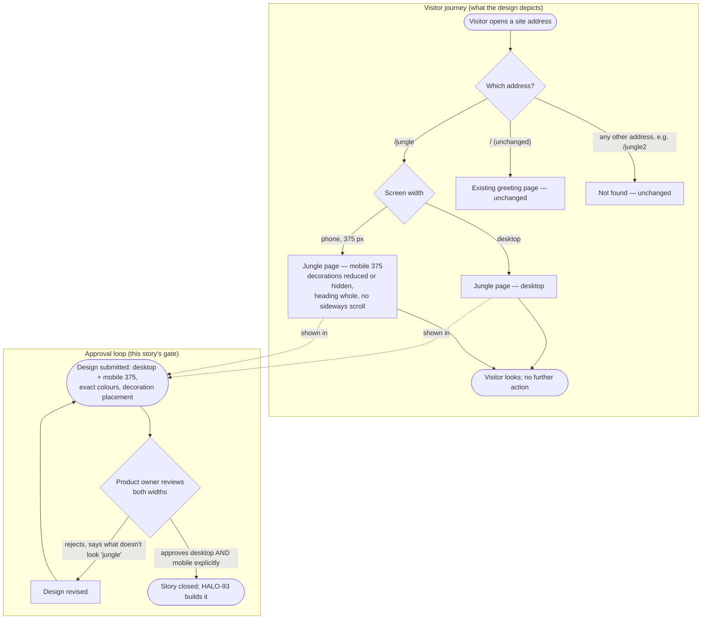

# Structure — Jungle page "Hello World!" (HALO-92)

One new, static screen at `/jungle`: a large centred **"Hello World!"** on a jungle-coloured background, framed by original plant shapes (leaves, vines, bushes). The visitor only looks; there is nothing to click. This story designs that screen in two widths — **desktop** and **phone at 375 px** — and ends when the product owner explicitly approves both (AC 1, AC 5). HALO-93 then builds it exactly as approved.

The existing greeting page at `/` and the "Not found" response for every other address are **unchanged and out of scope**. They appear below only to mark the edges of the journey.

## Personas

| Persona | Who (source) | Needs | Pain points |
|---|---|---|---|
| **Product owner — page owner and approver** (story persona) | "Ally PO & DEV", who asked for the epic and owns the demo page (story; PRD §1.2, §3 step 4, §5) | See the whole page in both widths before anything is built. Exact colours for the background, the heading and each kind of decoration, all from the agreed palette: deep green, leaf green, earth brown, yellow and orange accents (AC 1). A heading that is clearly the biggest thing on the page, with contrast of at least 3:1 (AC 2). Know which decorations shrink or hide at 375 px (AC 3). A way to reject with feedback and get a revised version (AC 5) | "Jungle-inspired" is open to interpretation, so the result may not match what they imagined (RK3). Wants the page built once, without rounds of fixes after the build (story) |
| **Page visitor** (the person the design is for) | Anyone who opens `/jungle` in a browser on a computer or a phone. No login and no action (PRD §1.2, §3 steps 1–3; HALO-93) | Read the whole greeting at a glance on any screen. A colourful, memorable page that makes them smile (PRD §2) | Decorations that cover or crowd the heading, especially on a phone (RK1). Dark or busy jungle colours that make the heading hard to read (RK2). Sideways scrolling on a narrow screen (R7) |

## User interaction

## Screen inventory

| Screen | Purpose | Main elements | States |
|---|---|---|---|
| **Jungle page — desktop** | Show the greeting as the page's single, dominant element in jungle styling (R1–R4, R13) | Background in the jungle palette. **"Hello World!"** (with the exclamation mark) as the only heading: centred, the largest element, at least 3:1 contrast against the colour directly behind it (R6). Plant decorations (leaves, vines, bushes) as original shapes framing the heading on the edges and corners, never over a letter (R5). Browser tab title includes "Hello World" (R8). No links, buttons, forms, other text, animals, background photo, custom font or motion (AC 4) | **Default**: the only state. **Loading**: n/a. The page is static and fully self-contained (R11), so the design defines no loading treatment. **Error**: n/a. A wrong address goes to *Not found*. **Empty**: n/a. The content is fixed |
| **Jungle page — mobile 375** | The same page at 375 px: the heading stays whole and readable (R7, AC 3) | Same palette and heading. The heading may wrap to two lines ("Hello" / "World!") but never runs past the screen edge. The design marks **which decorations shrink and which are hidden** at this width. No decoration overlaps any letter. No sideways scrolling | **Default**: the only state. Loading / error / empty: n/a, same as desktop |
| **Existing greeting page — unchanged** | Edge of the journey: `/` keeps today's plain "Hello World" page (no exclamation mark, no link to `/jungle`) (R12) | Not redesigned. Shown for reference only | Unchanged. Out of scope |
| **Not found — unchanged** | Edge of the journey: every address other than `/` and `/jungle` still returns "Not found" with no file listing (R12) | Not redesigned. Shown for reference only | Unchanged. Out of scope |

## Open branches

I set a default for each of these so the journey is complete. Please confirm or change them.

1. **Desktop reference width.** Default: the desktop design is drawn at **1440 px**. Between 376 px and desktop, the page scales smoothly, with no third layout. Do you want a separate tablet width (for example 768 px) as well?
2. **Heading on the phone.** Default: at 375 px the heading may wrap to two lines ("Hello" / "World!") so it can stay large. Should it stay on one line at a smaller size instead?
3. **Decorations at 375 px.** Default: the corner and edge leaves stay but get smaller, and the side vines are hidden so the heading has room. Is there a decoration you want to keep on the phone at all costs?
4. **What the heading sits on.** Default: a solid deep-green background behind the heading, with the heading in yellow to keep contrast well above 3:1. Decorations only sit in the outer frame. Alternatively the heading could sit on a lighter leaf-green panel with deep-green text. Which do you prefer?
5. **Heading font.** Default: the system's standard bold font, since a custom font is out of scope (AC 4). The jungle character comes only from colour and plant shapes. Confirm.
