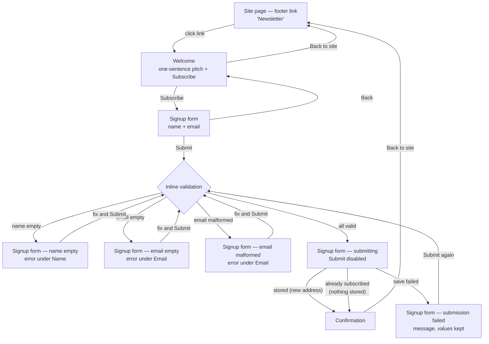

# Structure — Newsletter signup journey (SCRUM-102)

The journey has three screens and needs no account: **Welcome → Signup form → Confirmation**. Visitors reach it from a "Newsletter" link in the site footer (R1). Each screen is designed at desktop and mobile widths and meets WCAG 2.1 AA for colour and focus order (R4, AC 1, AC 3). The form shows inline errors for an empty name, an empty email and a malformed email (R2, AC 2). An address that is already subscribed gets the same Confirmation as a new one (R3). Storing signups and the export are out of scope: they belong to SCRUM-103.

This structure is based on the version approved on 2026-11-23 in the earlier run of this story (branch `halo/feat/scrum-102-20261119-100458`, commit `04cc1a5`). The decisions taken then are listed under Open branches.

## Personas

| Persona | Who (source) | Needs | Pain points |
|---|---|---|---|
| **Site visitor** (main persona) | A visitor to the public site who wants the newsletter (story, PRD summary, R1) | Understand the newsletter in one sentence. Subscribe in under a minute with only a name and an email address. See clearly that it worked. | Today, addresses are collected by hand over email (PRD summary). May be on a phone (R4, AC 1). Needs to see which field is wrong without losing what they already typed (R2). |
| **Visitor using a keyboard or screen reader** | The same visitor, without a mouse or listening to the page (R4, AC 3) | A logical focus order on every screen. Errors that are announced and tied to their field. Colour contrast that meets AA. | Errors shown only by colour. Focus left on Submit while the field in error is above it. |
| **Returning subscriber** | A visitor whose address is already on the list and who submits it again (R3, SCRUM-103 scenario 2) | Finish the journey without trouble. | Must get no error, and must not learn whether the address was already on the list. |

## User interaction

Several errors can show at once, each under its own field: for example, name empty together with email malformed. The diagram shows each error separately only to keep it readable. When errors show, focus moves to the first field in error.

## Screen inventory

| Screen | Purpose | Main elements | States (default / loading / error / empty) | Based on |
|---|---|---|---|---|
| Site page — footer link | Entry point: the site footer links to the newsletter (R1) | The existing page content, plus a new footer with a "Newsletter" link | Default only. The page has no footer today, so this story adds one. | `test-repo-for-halo-7ad879b52d/docs/index.html` |
| Welcome | Explains the newsletter and starts the signup (R1) | Heading, one-sentence explanation, primary "Subscribe" button, "Back to site" link | Default only: the content is static, so there is no loading, error or empty state. | new |
| Signup form | Collects the name and email address (R2) | Heading; Name field (1–80 characters, capped by `maxlength`); Email field; "Submit" button; "Back" link; an error slot under each field | Default, plus the five states below | new |
| Signup form — name empty | Tells the visitor the name is missing (R2, AC 2) | Inline error under Name, linked to the field with `aria-describedby`; focus on the first field in error | Error | new |
| Signup form — email empty | Tells the visitor the email is missing (R2, AC 2) | Inline error under Email, linked to the field; the name already typed is kept | Error | new |
| Signup form — email malformed | Tells the visitor the address is not valid (R2, AC 2) | Inline error under Email showing the expected format; the typed value is kept | Error | new |
| Signup form — submitting | Shows the signup is being sent, and stops a second submit | Submit disabled with a busy label; fields read-only | Loading | new |
| Signup form — submission failed | Tells the visitor the save did not go through (network or server error) | Message above the form; values kept; Submit enabled again | Error | new |
| Confirmation | Tells the visitor they are subscribed, whether the address is new or already on the list (R3) | Success heading, short message, "Back to site" link | Default only: no loading, error or empty state | new |

## Open branches

1. **Footer link in scope?** The story's "In" list names only the welcome, form and confirmation screens. The entry point, a "Newsletter" link in a new footer on `docs/index.html`, comes from R1 and from the earlier approved structure. Should this story keep designing the footer link, or leave it to the story that builds the page? I recommend keeping it: R1 places the entry in the footer, and the page has no footer for a later step to rebuild. If you answer that another story owns the site footer, I will drop the row and start the journey at Welcome.

These decisions from the earlier approved run stay settled:

- **Submission failed is kept.** "Signup form — submission failed" keeps what the visitor typed and lets them submit again.
- **Name is capped at 80 characters.** The cap is set with `maxlength`, so there is no "name too long" error. The form keeps exactly the three errors AC 2 lists.
- **Visual base.** The new screens start from the `tokens.css` of the approved newsletter design in story `0e4e726a`. They do not reuse its email-only form or its consent checkbox: R2 asks for a name and an email address, with no consent box.
