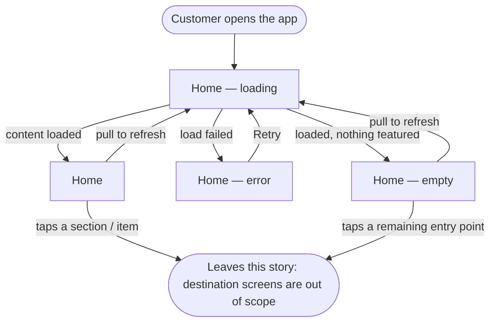

# SCRUM-105 — Neighbourhood cafe app: home screen — user journey

Scope: the story asks for **one screen only** — the home screen of a neighbourhood cafe's mobile app. No PRD, research or attachments came with it, and no checkout holds a cafe app (the spec repository has a Bash greeting script and unrelated design stories), so the screen is `new`. Destinations reached *from* home (menu, ordering, etc.) are outside this story and drawn as a single exit, not as screens.

## Personas

| Persona | Source | Needs | Pain points |
|---|---|---|---|
| **Neighbourhood customer** — a person living or working near the cafe who opens its mobile app | Story: "a neighbourhood cafe's mobile app" | Open the app and see at a glance which cafe this is and what it offers today; get from home to whatever they came for in one tap | Waiting on a blank screen while content loads; a home screen that fails silently or shows nothing when there is no content |

The story names no other user (no staff/owner view, no first-time vs. returning split), so none is added. What exactly the customer comes for is not stated — see Open branches.

## User interaction

## Screen inventory

| Screen | Purpose | Main elements | States | Based on |
|---|---|---|---|---|
| Home | First screen of the cafe app: tells the customer which cafe this is and gives one-tap entry to what it offers | Cafe name / logo header; a featured area (e.g. today's highlights — content to be confirmed, see Open branches); entry points to the app's main areas; pull to refresh | **default**: header + featured area + entry points · **loading**: header shown, skeleton placeholders for the featured area · **error**: header shown, short "couldn't load" message with a Retry button · **empty**: header + entry points, featured area replaced by a friendly "nothing featured right now" note | new |

`Home — loading`, `Home — error` and `Home — empty` in the diagram are the states of this one row, not separate screens.

## Open branches

1. **What goes on the home screen?** The story says only "design the home screen". Options: (a) brand header + featured items + a "View menu" entry; (b) (a) plus opening hours / "open now" status and location; (c) (b) plus an "Order ahead" call to action. I recommend **(b)**: for a *neighbourhood* cafe, "is it open and where is it" is the most likely reason to open the app, and it adds no flow beyond this one screen; (c) would imply an ordering journey the story does not ask for. Tell me if the app takes orders and I'd switch to (c).
2. **Navigation pattern** — a bottom tab bar (Home / Menu / …) or a single scrolling home with cards? I recommend **a bottom tab bar with Home selected**: it is the standard mobile pattern and makes the out-of-scope destinations visible without designing them. If the app will only ever have this one screen, a plain scrolling page is enough.
3. **Signed-in or anonymous?** Should home greet a known customer (name, loyalty points) or be the same for everyone? I recommend **anonymous**: nothing in the story mentions accounts or loyalty, and adding them would add a sign-in journey. Tell me if a loyalty programme exists and I'll add a greeting/points card.
