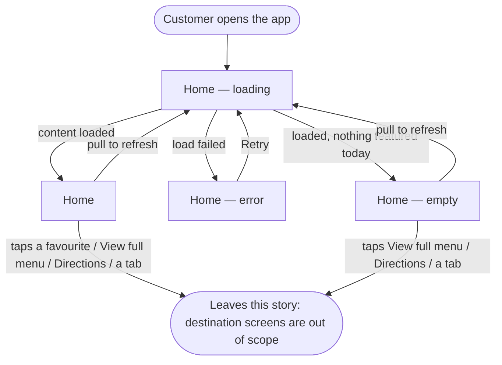

# SCRUM-106 — Neighbourhood cafe app: home screen — user journey

Scope: the story asks for **one screen only** — the home screen of a neighbourhood cafe's mobile app. It is a **clone of SCRUM-105** (linked "Cloners"), whose design is already approved at structure, prototype and screens (`stories/SCRUM-105/design/approval.json` on `origin/halo/feat/scrum-105-20261119-130701`). No PRD, research or attachments came with this story, and no product code in the checkout renders a cafe app, so the screen is rebuilt from the SCRUM-105 design rather than invented. Destinations reached *from* home (menu, item detail, directions, other tabs) stay out of scope and are drawn as a single exit.

Carried over from the approved SCRUM-105 design (its open branches, as resolved in the approved prototype): home shows **brand header + "Open now"/hours + address with Directions + "Today's favourites" + "View full menu"**; navigation is a **bottom tab bar** (Home · Menu · Visit · More) with Home selected; the screen is **anonymous** (no sign-in, no loyalty).

## Personas

| Persona | Source | Needs | Pain points |
|---|---|---|---|
| **Neighbourhood customer** — a person living or working near the cafe who opens its mobile app | Story: "a neighbourhood cafe's mobile app"; same persona as SCRUM-105 | See at a glance which cafe this is, whether it is open now and where it is, and what's good today; get to the menu or directions in one tap | Waiting on a blank screen while content loads; a home screen that fails silently or shows nothing when there is no featured content |

The story names no other user (no staff/owner view, no first-time vs. returning split), so none is added.

## User interaction

## Screen inventory

| Screen | Purpose | Main elements | States | Based on |
|---|---|---|---|---|
| Home | First screen of the cafe app: tells the customer which cafe this is, whether it is open and where, and gives one-tap entry to what it offers | Cafe logo + name + tagline header; hours card ("Open now", today's hours, closing countdown) with address and **Directions**; "Today's favourites" horizontal cards (image, name, short note, price); **View full menu** button; bottom tab bar Home · Menu · Visit · More; pull to refresh | **default**: all elements above · **loading**: header and tab bar shown, skeleton placeholders for hours card and favourites · **error**: header and tab bar shown, short "couldn't load" message with a **Retry** button · **empty**: header, hours card, View full menu and tab bar shown; favourites row replaced by a friendly "nothing featured right now" note | `test-repo-for-halo-7ad879b52d/stories/SCRUM-105/design/screens/home.default.mobile.html` (branch `origin/halo/feat/scrum-105-20261119-130701`; sibling files `home.loading`, `home.error`, `home.empty` `.mobile.html` for the other states, `prototype/home.html` for the interactive version) |

`Home — loading`, `Home — error` and `Home — empty` in the diagram are the states of this one row, not separate screens.

## Open branches

1. **Reuse SCRUM-105 as-is, or diverge?** This story is a clone and adds no new requirement. Options: (a) carry the approved SCRUM-105 home screen over unchanged (content, tab bar, anonymous, four states); (b) keep the journey but restyle or rebrand it (different cafe name, palette, featured content); (c) re-open the content decision, e.g. add an "Order ahead" call to action. I recommend **(a)**: the story text is identical to SCRUM-105 and that design is already approved end to end, so anything else would be scope the story does not ask for. Tell me what this clone is meant to change (a different cafe, ordering, a loyalty card) and I'll switch to (b) or (c) and update the journey.
