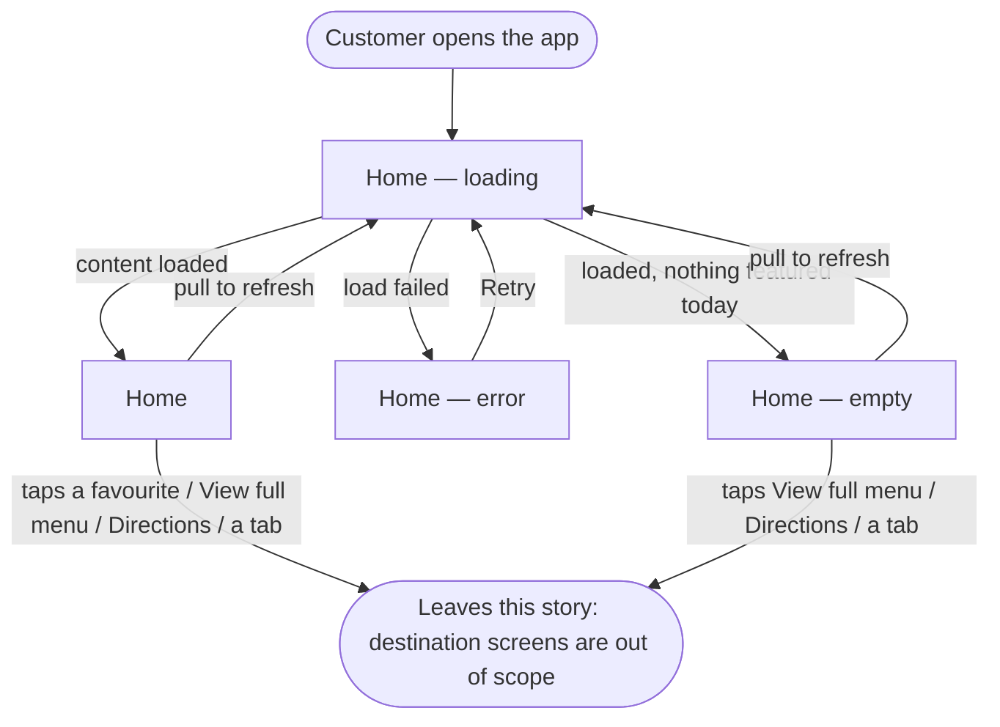

# SCRUM-107 — Neighbourhood cafe app: home screen — user journey

Scope: the story asks for **one screen only**, the home screen of a neighbourhood cafe's mobile app. It is a **clone of a clone**. Its linked "Cloners" story is SCRUM-106, which was itself cloned from SCRUM-105. All three have the same story text. SCRUM-106 is approved at structure, prototype and screens (`stories/SCRUM-106/design/approval.json` on `origin/halo/feat/scrum-106-20261119-132430`, approved 2026-11-19). Its screens match SCRUM-105's, apart from the story key. No PRD, research or attachments came with this story, and no product code in the checkout renders a cafe app. So the screen is rebuilt from the approved SCRUM-106 design, not invented. The screens you can reach *from* home (menu, item detail, directions, other tabs) are out of scope and appear as a single exit.

Carried over from the approved SCRUM-106 design ("Corner Bean"):
- **Content:** brand header, then "Open now" with today's hours, the address with **Directions**, "Today's favourites" and **View full menu**.
- **Navigation:** a **bottom tab bar** (Home · Menu · Visit · More) with Home selected.
- **Access:** the screen is **anonymous**, with no sign-in and no loyalty programme.

## Personas

| Persona | Source | Needs | Pain points |
|---|---|---|---|
| **Neighbourhood customer**: someone who lives or works near the cafe and opens its mobile app | Story: "a neighbourhood cafe's mobile app". The same persona as in SCRUM-106 and SCRUM-105 | See at a glance which cafe this is, whether it is open now, where it is and what's good today. Reach the menu or directions in one tap | Staring at a blank screen while content loads. A home screen that fails without saying so, or shows nothing when there is no featured content |

The story names no other user (no staff or owner view, no first-time vs. returning split), so none is added.

## User interaction

## Screen inventory

| Screen | Purpose | Main elements | States | Based on |
|---|---|---|---|---|
| Home | The cafe app's first screen. It tells the customer which cafe this is, whether it is open and where it is, and gives one-tap access to what it offers | Header with the cafe's logo, name and tagline. Hours card with "Open now", today's hours and a closing countdown, plus the address and **Directions**. "Today's favourites" as a horizontal row of cards (image, name, short note, price). **View full menu** button. Bottom tab bar: Home · Menu · Visit · More. Pull to refresh | **Default:** everything listed. **Loading:** header and tab bar shown, with skeleton placeholders for the hours card and favourites. **Error:** header and tab bar shown, with a short "couldn't load" message and a **Retry** button. **Empty:** header, hours card, View full menu and tab bar shown; the favourites row is replaced by a friendly "nothing featured right now" note | `test-repo-for-halo-7ad879b52d/stories/SCRUM-106/design/screens/home.default.mobile.html` (branch `origin/halo/feat/scrum-106-20261119-132430`). The other states are in the sibling files `home.loading`, `home.error` and `home.empty` `.mobile.html`. The interactive version is `prototype/home.html` |

`Home — loading`, `Home — error` and `Home — empty` in the diagram are states of this one row, not separate screens.

## Open branches

1. **Should this clone reuse SCRUM-106 as-is, or change something?** The story adds no new requirement. Options:
   - (a) Carry over the approved SCRUM-106 home screen unchanged: same content, tab bar, anonymous access and four states.
   - (b) Keep the journey but restyle or rebrand it: a different cafe name, palette or featured content.
   - (c) Reopen the content decision, for example by adding an "Order ahead" call to action.

   I recommend **(a)**: the story text matches SCRUM-106 and SCRUM-105, and that design is already approved end to end. Anything else would add scope the story doesn't ask for. If this clone is meant to change something (a different cafe, ordering, a loyalty card), tell me and I'll switch to (b) or (c) and update the journey.
