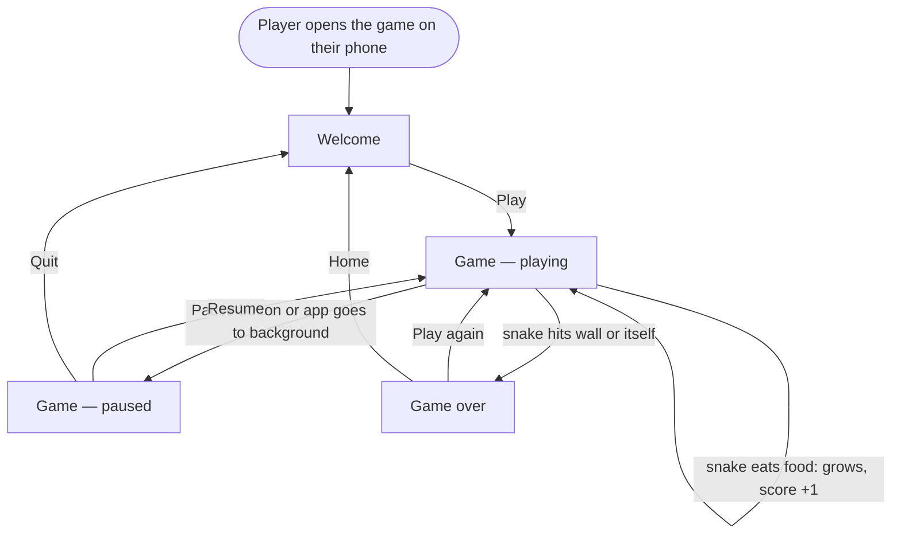

# Structure — Snake game for mobile

Three screens, phone-only, portrait: **Welcome → Game → Game over**, and from Game over back into a new game (story AC 1–3). The product has no snake game today, so all three screens are `new`.

## Personas

| Persona | Who (source) | Needs | Pain points |
|---|---|---|---|
| **Passenger gamer** (only persona) | "A gamer" who wants "a simple snake game on my mobile phone to play on long drives" (story) | Start playing in one tap; simple controls that work on a phone held in one hand; a snake that looks good ("snazzy", AC 2); a quick way to play again after losing | A long drive means short, repeated sessions with interruptions (stops, calls, car motion); a game that is complicated to start or to restart gets in the way |

The story names no other user. "Passenger" is my reading of "on long drives": the game is played by someone who is not driving.

## User interaction

## Screen inventory

| Screen | Purpose | Main elements | States | Based on |
|---|---|---|---|---|
| **Welcome** | Open the game and get the player into a run in one tap (AC 1) | Game title; the styled snake as a decoration, so the look is set from the first screen; one main action, **Play**; one line on how to steer | **Default**: the only state. **Empty**: n/a (no data to show). **Loading**: n/a. **Error**: n/a | new |
| **Game** | Play: steer the snake to the food, grow, avoid crashing (AC 2) | Square play field that fits the phone width; the snake, styled (head with eyes, a gradient or patterned body); the food; current score; **Pause** button; the steering control (see open branch 1) | **Default (playing)**: snake moving, score counting. **Paused**: play field dimmed, **Resume** and **Quit** shown; entered with the Pause button or on its own when the app goes to the background (a call, a stop). **Empty**: n/a. **Loading**: n/a. **Error**: n/a | new |
| **Game over** | Tell the player the run ended and let them play again at once (AC 3) | "Game over" heading; final score; main action **Play again**; secondary action **Home** (back to Welcome) | **Default**: the only state. **Empty / loading / error**: n/a | new |

## Open branches

I set a default for each one so the journey is complete. Please confirm or change them.

1. **Steering.** Default: swipe anywhere on the play field to turn. An on-screen arrow pad is the other option. I recommend swipe: it works with one thumb and leaves the whole screen for the play field. On-screen arrows would be the better choice if you expect players to find swipes unreliable in a moving car.
2. **Walls.** Default: hitting the edge of the play field ends the game, like hitting the snake's own body. The other option is that the snake comes out on the opposite side and only hitting itself ends the game. I recommend walls end the game: it is the classic rule and the simplest to explain on Welcome.
3. **Best score.** Default: none. The story does not ask for one, so Game over shows only the score of this run. If you want a best score kept on the phone, it would show on Welcome and on Game over (with a "New best!" variant of Game over).
4. **Pause.** Default: a paused state of the Game screen, not a separate screen; it opens on its own when the app goes to the background. The story does not mention pausing; I added it because a game played on long drives will be interrupted. Drop it if you want the strictly three-screen minimum.
5. **Orientation and sound.** Default: portrait only, no sound. The story says neither. Say if you want landscape or a sound on/off toggle.
