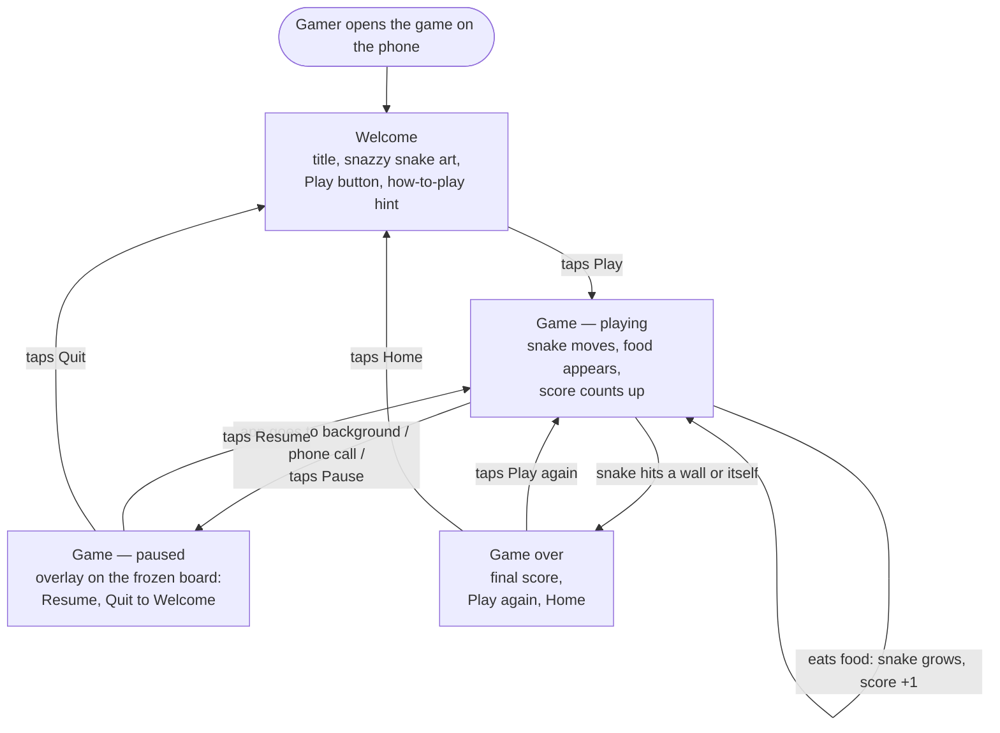

# Structure — Snake game for mobile (SCRUM-113)

A simple snake game for a mobile phone, played to pass time on long drives. The story asks for three screens (AC 1–3): **Welcome**, **Game** (with a "snazzy looking snake") and **Game over**. None exists today: the checkout (`test-repo-for-halo-7ad879b52d`) has no game, so every screen is `new`. The design is drawn at phone width, in portrait.

Where the sources say nothing, this map takes the simplest option that keeps the journey complete (the game runs entirely on the phone, with swipe controls, the score shown on Game over and an automatic pause on interruption). Each of these choices is listed under **Open branches** for you to confirm or change.

## Personas

| Persona | Who (source) | Needs | Pain points |
|---|---|---|---|
| **Gamer on a long drive** | "As a gamer, I want a simple snake game on my mobile phone to play on long drives" (SCRUM-113 user story) | A **simple** game: one tap from Welcome into play, no setup or account (story: "simple"). Playable on a **phone** screen, by touch (story: "mobile phone"). A snake that looks good (AC 2). A clear end of the round and a fast way to play again, to fill a long drive with many short rounds (AC 3; story: "long drives") | A drive brings interruptions and patchy signal (*inferred from "long drives"*, not stated): a round that keeps running while the phone is set aside, or a game that needs the network, would let them down. Anything that isn't simple, such as menus, sign-up or settings before play (story: "simple") |

The ticket names no other user. The product owner and designer approve the design but do not use the game, so they get no persona here.

## User interaction

The game makes no network calls, so the journey has no error screens. It starts with an empty board (the snake and one piece of food) and no score, so Game has no empty state either. Both are recorded per screen below.

## Screen inventory

| Screen | Purpose | Main elements | States (default / loading / error / empty) | Based on |
|---|---|---|---|---|
| **Welcome** | Entry point: say what this is and start a round in one tap (AC 1) | Game title, snazzy snake illustration (same look as in play), large **Play** button within thumb reach, one-line hint "Swipe to steer" | **default:** as described. **loading:** while assets load on first open, title and art are shown with the Play button disabled. **error:** n/a (works offline). **empty:** n/a | `new` |
| **Game — playing** | The round itself, with the snazzy snake (AC 2) | Square board fitted to the phone width, snake (styled head with eyes, patterned body, smooth movement), food item, current score at the top, Pause button. Swipe anywhere on the board to steer | **default:** snake moving, score showing. **loading:** n/a (assets come in on Welcome). **error:** n/a. **empty:** start of round with score 0, a short snake and one food item | `new` |
| **Game — paused** | Hold the round when the gamer is interrupted on the drive | Dimmed, frozen board behind an overlay: "Paused", current score, **Resume** (primary), **Quit** (back to Welcome) | **default:** as described. Opens on its own when the app is sent to the background. **loading / error / empty:** n/a | `new` |
| **Game over** | End the round clearly and get the gamer back in fast (AC 3) | "Game over" heading, final score, the snake shown at its collision point (or a crashed-snake illustration), **Play again** (primary), **Home** (back to Welcome) | **default:** as described. **loading / error / empty:** n/a (the score is always ≥ 0) | `new` |

## Open branches

1. **Controls: swipe only, or swipe plus an on-screen arrow pad?** The story only says "mobile phone". I recommend **swipe only**: it keeps the board large and the game simple, as the story asks. Choose the arrow pad if a passenger in a moving car would find swiping too imprecise.
2. **Best score: remember it on the phone, or show only this round's score?** The ACs don't mention a best score. I recommend **this round's score only**, as drawn: it is the simplest option and needs no stored data. If you want a "Best" score, it goes on Welcome and Game over, and the first-ever round needs a "no best yet" empty state.
3. **Pause: automatic only, or a Pause button as well?** The map includes both: an automatic pause when the app leaves the screen, and a Pause button on the board. I recommend keeping both, because interruptions are common on a drive. If you want the Game screen to have nothing but the board and the score, drop the button and keep only the automatic pause.
4. **Speed: fixed, or faster as the snake grows?** Speed is not a screen, but it changes how Game feels. I recommend **getting a little faster as the score rises**: it is classic snake behaviour and adds no extra screen.
