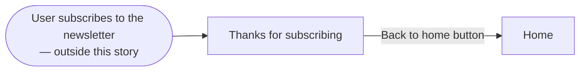

# SCRUM-114 — "Thanks for subscribing" page: user journey

## Personas

| Persona | Source | Needs | Pain points |
|---|---|---|---|
| **New newsletter subscriber** — a visitor who has just subscribed to the newsletter | SCRUM-114 summary | Clear confirmation that the subscription went through; an obvious way back to the home page | Being left unsure whether subscribing worked; a dead-end page with nowhere to go next |

No other persona is named in the story or its context.

## User interaction

The page is static: it shows fixed text and has no loading, error or empty state. A failed subscription never reaches this page; that path belongs to the subscribe flow, which is outside this story.

## Screen inventory

| Screen | Purpose | Main elements | States | Based on |
|---|---|---|---|---|
| Thanks for subscribing | Confirm that the newsletter subscription succeeded and send the user onward | Heading (e.g. "Thanks for subscribing!"); one sentence of confirmation; a "Back to home" button | default only (static content; no loading / error / empty) | `new` |
| Home | Where the button goes; this story does not change it | Existing page: "Hello World" heading | default (unchanged) | `test-repo-for-halo-7ad879b52d/docs/index.html` |

## Open branches

none — the story fixes the content (heading, one sentence, home button) and the single exit. The exact wording is left to the copy in the next step and defaults to: heading "Thanks for subscribing!", sentence "You're on the list — look out for our next newsletter in your inbox.", button "Back to home".
