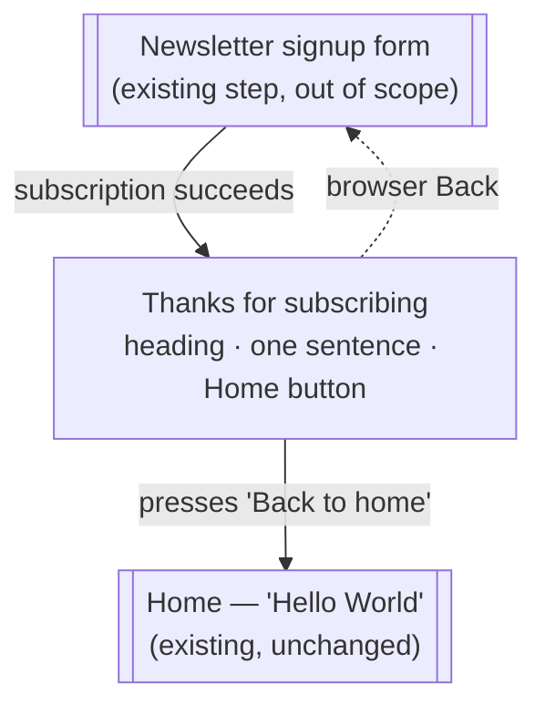

# Structure — "Thanks for subscribing" page (SCRUM-114)

One new screen, **Thanks for subscribing**, shown right after a user subscribes to the newsletter: a heading, one sentence, and a button back to the home page (AC 1). It is a static page: no data loads, nothing can be empty, and nothing on it can fail.

Edges of the journey (not designed here):
- **Newsletter signup form**: where the user subscribes. The story names it as the step before this page; no checkout holds it (`docs/` has only the home page and `jungle.html`), so it appears as an edge only.
- **Home**: the button's target, the existing "Hello World" page at `test-repo-for-halo-7ad879b52d/docs/index.html`, unchanged.

## Personas

| Persona | Who (source) | Needs | Pain points |
|---|---|---|---|
| **Newsletter subscriber** | A user who has just subscribed to the newsletter (story) | To know at a glance that the subscription went through (heading + sentence). One clear way to continue: back to the home page (home button) | Being left on a dead-end page with no way forward. Unsure whether the subscription worked |

## User interaction

No error, loading or empty state: the page has static content only and is reached only after a successful subscription. A failed subscription is handled by the signup form, outside this story.

## Screen inventory

| Screen | Purpose | Main elements | States (default / loading / error / empty) | Based on |
|---|---|---|---|---|
| Thanks for subscribing | Confirm the newsletter subscription and send the user back home | Heading (e.g. "Thanks for subscribing!"); one sentence confirming the subscription; primary button "Back to home" linking to the home page | default only — loading: n/a (static); error: n/a (only reached on success); empty: n/a (fixed copy) | new |
| Newsletter signup form (edge) | Where the user subscribes; entry to this page | Not designed in this story | Not designed in this story | not found |
| Home (edge) | Target of the home button | Existing "Hello World" heading, unchanged | Not changed by this story | test-repo-for-halo-7ad879b52d/docs/index.html |

## Open branches

1. **Copy.** The story fixes the shape (heading, one sentence, button) but not the words. Proposed: heading "Thanks for subscribing!", sentence "You're on the list — the next issue will arrive in your inbox.", button "Back to home". Do you want different wording (e.g. mention a confirmation email, if subscriptions are double opt-in)?
2. **Visual style.** The home page is plain system-font HTML. I'll match it (system font, simple centred layout) unless you want a specific newsletter brand look.
