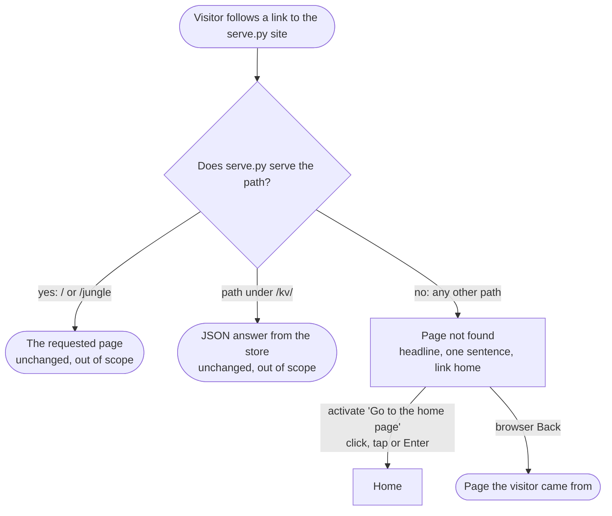

# Structure — Friendly 404 page for the serve.py site (SCRUM-123)

One new screen, **Page not found**, at desktop and mobile widths. It replaces the stock error page the server shows today and leads back to **Home** (`/`). Wiring it into `serve.py` is a later development story; this design only defines the screen.

**What exists today.** `serve.py` serves exactly two pages, `/` (`docs/index.html`) and `/jungle` (`docs/jungle.html`). Any other path reaches `self.send_error(404)` in `RootOnlyHandler.do_GET`, which renders Python's built-in `BaseHTTPRequestHandler` error page: a bare "Error response / Error code: 404 / Message: Not Found." with no viewport meta and no way back. The site's look comes from `docs/index.html`: a plain white page, `system-ui, sans-serif`, `main { padding: 1rem }`, a single `<h1>`.

## Personas

| Persona | Who (source) | Needs | Pain points |
|---|---|---|---|
| **Visitor who followed a broken link** (only persona) | Someone who opened a link to the serve.py site that points to a path the server does not serve (story) | Understand at a glance that the page does not exist; one clear way back to the home page; a page readable on desktop and on a phone; a link reachable and visible by keyboard; readable contrast (story ACs) | Today they get the stock Python error page ("Error code: 404, Message: Not Found."): technical wording, no link home, and no viewport meta, so it is tiny on a phone (`serve.py`, `send_error(404)`) |

## User interaction

## Screen inventory

| Screen | Purpose | Main elements | States | Based on |
|---|---|---|---|---|
| **Page not found** | Tell the visitor the page does not exist and send them home (story) | Page `<title>` "Page not found"; optional simple text mark "404" above the headline (no illustration); `<h1>` short headline, e.g. "Page not found"; one sentence, e.g. "The link you followed may be broken, or the page may have moved."; one link **Go to the home page** to `/`, with a visible focus outline; same plain light look as Home (white background, `system-ui`, 1rem padding); fits 320 px wide with no horizontal scroll | **Default**: the only state, the same at desktop and mobile widths (mobile: same content, one column, the link has a comfortable tap area). Loading: n/a (static page). Error: n/a (this screen *is* the error). Empty: n/a | `test-repo-for-halo-7ad879b52d/serve.py` (`RootOnlyHandler.do_GET` → `send_error(404)`, the stock page shown today); look from `test-repo-for-halo-7ad879b52d/docs/index.html` |
| **Home** | Destination of the link; not changed by this story | "Hello World" heading | **Default** only; unchanged | `test-repo-for-halo-7ad879b52d/docs/index.html` |

## Open branches

The project's standing rule is that agents decide open points themselves, so each item below is a decision I made and recorded, not a question. Change any of them if you disagree.

1. **The requested path is not shown on the page.** Decided: the screen does not repeat the broken URL back to the visitor. It is not needed to understand what happened, and printing request input into the page creates an injection risk for the development story.
2. **"Simple mark" is a large, muted "404" in text, or nothing.** Decided: a text "404" above the headline, using the page font. No SVG or image, so the page needs no extra request, the same as the existing pages. The headline stays the `<h1>`; the mark is decorative and hidden from screen readers.
3. **One link only.** Decided: the screen links to Home (`/`) only, not to `/jungle`, and has no "go back" button. The story asks for one clear link home, and the browser's Back button already covers going back.
4. **Copy.** Decided: headline "Page not found", sentence "The link you followed may be broken, or the page may have moved.", link "Go to the home page". The link text makes sense on its own when read out of context (accessibility).
5. **Scope of other errors.** Decided: only the HTML 404 for page paths gets this screen. `/kv/` 404s stay JSON (the API contract in `serve.py`), and the stock 501 page for PUT/DELETE outside `/kv/` is left as it is.
