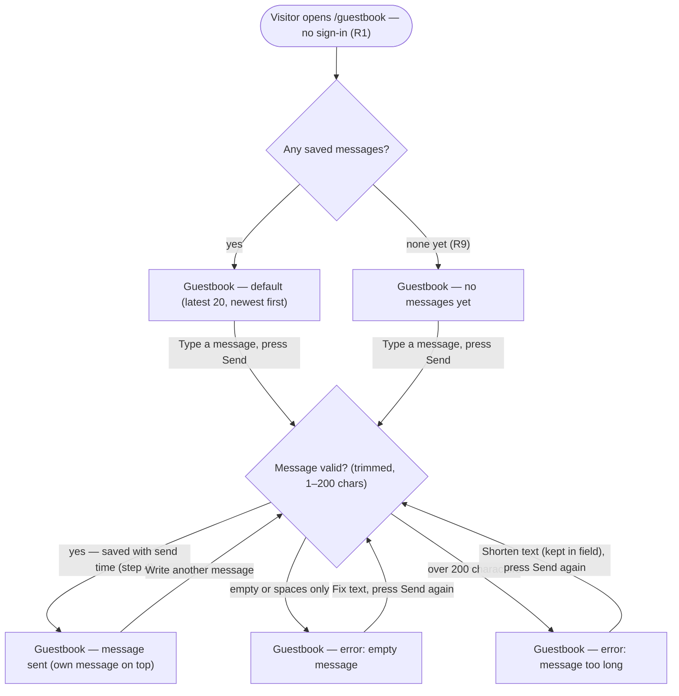

# SCRUM-125 — Structure: the visitor journey for the `/guestbook` page

Story: SCRUM-125 (design of the guestbook page, desktop and 360 px phone). Built by SCRUM-126.
Sources: Epic PRD SCRUM-124 v1 (§1.2, §3 steps 1–5 and exception paths, §4 R1, R2, R4, R5, R7, R8, R9, §6 RK3, §7 decisions, §8 out of scope), User Story Backlog v1 (US-01 / US-02 acceptance criteria), repository `serve.py`, `docs/index.html`, `docs/jungle.html`.
Out of scope for this journey (AC 6, PRD §8): the home page `/` and the `jungle` page are not redesigned and get no link to the guestbook; accounts, sender name, deleting, paging beyond 20, replies, likes, rate limiting.

## Personas

| Persona | Who (source) | Needs | Pain points today |
| --- | --- | --- | --- |
| **Anonymous visitor** (primary, uses the page) | Anyone who opens the small site served by `serve.py`, on a desktop or a phone, with no account and no sign-in (PRD §1.2, R1). | Open `/guestbook` and see the latest messages at once (R4). Write one line, at most 200 characters, and send it (R2). See their message at the top right after sending (R3). When a message is refused, read why and fix it without retyping (R5, US-01 AC 3). Read and write on a 360 px phone with no sideways scrolling and no zoom (R8). | The site shows only fixed pages (`/`, `/jungle`); a visitor has no way to leave a mark (PRD §1.1). |
| **Product manager** (approves the design) | The site's product manager, the "as a" of SCRUM-125 (story text). | One approved look and behaviour for every state of the page — default, empty, both errors, long and code-like messages — on desktop and 360 px, so the page is built once (story text, AC 1–5). Certainty that no other page is touched (AC 6, R10). | No design exists; without it SCRUM-126 cannot build the page as intended (PRD §5). |

Context that shapes the journey:

- No accounts, so there is no sign-in, permission or "who wrote this" branch; each message shows its send time only (PRD §7).
- The only validation is length: empty / spaces only, or over 200 characters after trimming the ends (PRD §7). There is no content filter (RK1), so a message is always shown as plain text exactly as written (R7, RK3).
- The site today serves server-rendered pages with no client scripts (`serve.py` fixed routes, inline CSS only in `docs/*.html`); the journey therefore assumes a plain form post that returns a full page.

## User interaction

Reading notes:

- Every screen exists twice: desktop and 360 px phone (AC 1, 2, 4). The journey is the same at both widths; only layout changes.
- `Guestbook — message sent` is the default page after the post returns (PRD §3 step 5): the field is empty again and the visitor's message is first in the list. There is no separate success banner — the message at the top is the confirmation (R3).
- Both error screens re-show the whole page: the form with the visitor's text kept in the field and the error under it, and the list (or the "no messages yet" line) below unchanged (AC 3).
- A 200-character message with no spaces and a message containing markup or code are **content states of the list**, not separate screens (AC 5): they appear in `Guestbook — default` and `Guestbook — message sent`, wrapped inside the list and shown as plain text.
- The way back is the browser itself: there is no other page in this journey, no navigation to `/` or `/jungle` (AC 6).

## Screen inventory

| Screen | Purpose | Main elements (top to bottom) | States (default / loading / error / empty) | Based on |
| --- | --- | --- | --- | --- |
| **Guestbook — default** | Read the latest messages and write one (R1, R2, R4; AC 1, 2). | Page title "Guestbook"; form: one message field, Send button; list of exactly 20 messages, newest first, each with its send time beside it; 200-char no-space message wraps inside its row; code-like message shown as literal text. | Default: 20 messages. Loading: none drawn — a full server page (see Open branches 4). Error: see the two error screens. Empty: see `Guestbook — no messages yet`. Content states: long unbroken message, code-like message (AC 5). | `new` |
| **Guestbook — no messages yet** | First visitor sees the page is working, just empty (R9; AC 4). | Title; the same form; one line in place of the list saying there are no messages yet. | Empty (this screen); can also carry either error after a refused first send. | `new` |
| **Guestbook — message sent** | Show the visitor their message was saved (R3; PRD §3 step 5). | Title; form with the field cleared; list with the visitor's message first, with its send time, then the next 19. | Default (this screen). | `new` |
| **Guestbook — error: empty message** | Explain an empty or spaces-only message was not saved (R5; AC 3). | Title; form with the visitor's text (spaces) kept in the field, field marked invalid, short error under it ("Message is empty"); list unchanged below. | Error (this screen); list part may be the empty line. | `new` |
| **Guestbook — error: message too long** | Explain a message over 200 characters was not saved or cut, and the limit (R5; AC 3). | Title; form with the full text kept in the field, field marked invalid, error under it naming the limit ("Message is too long — 200 characters at most"); list unchanged below. | Error (this screen); list part may be the empty line. | `new` |

No existing screen is changed: `/guestbook` has no route in `test-repo-for-halo-7ad879b52d/serve.py` today (`ROUTES` holds only `/` and `/jungle`). The page should follow the plain style of `test-repo-for-halo-7ad879b52d/docs/index.html` (system font, `viewport` meta, `overflow-wrap: anywhere`) — that file is a style reference only and is not redesigned.

## Open branches

The product owner asked agents to decide and record rather than ask (product memory), so each branch below is a question for the designer with the option this structure has already adopted; an answer from the designer overrides it.

1. **Page language and direction.** Should the page chrome (title, button, errors, empty line) be English, like the existing site pages (`lang="en"`), or Hebrew RTL? Adopted: English chrome to match the site, with each message rendered in its own direction (`dir="auto"`) so Hebrew messages such as "שלום מכולם" (US-02 AC 1) read right to left. A Hebrew-first audience would change this to a Hebrew RTL page.
2. **Message field: single-line input or wrapping text box?** Adopted: a single-line field, because PRD §7 defines a message as one line and line breaks are not kept. A wrapping box would show all 200 characters when fixing the "too long" error; pick it if readability of the kept text matters more than the one-line metaphor.
3. **Hard character cap in the field.** Adopted: no browser cap (`maxlength`) and no live counter — a cap would make the "too long" screen unreachable, and AC 3 requires it; a counter is not in the sources.
4. **Sending state.** Adopted: no loading screen — the form posts and the server returns the full page, as the site works today. If the build adds a client script, a disabled "Sending…" button would be the state to add.
5. **Send-time format.** Adopted: absolute date and time, 24-hour, e.g. `2026-11-24 08:15`, small and secondary beside the message. Relative times ("5 minutes ago") would need a script or go stale on a static page.
