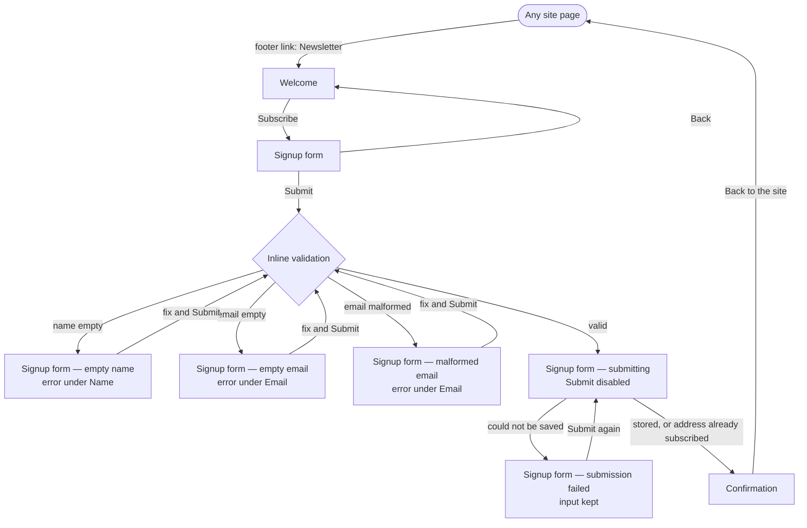

# Structure — Newsletter signup journey (SCRUM-99)

Three new screens, reached from the site footer: **Welcome → Signup form → Confirmation**. Each screen works at desktop and mobile widths and meets WCAG 2.1 AA (R4). Storing the signup and the CSV export belong to SCRUM-100 and are not designed here.

## Personas

| Persona | Who (source) | Needs | Pain points |
|---|---|---|---|
| **Site visitor** (main persona) | A visitor to the site who wants the newsletter (story, PRD R1–R3) | Understand the newsletter in one sentence; subscribe with only a name and an email address; see at once which field is wrong; know they are subscribed; finish in under a minute | Today there is no signup in the site, and addresses are collected by hand over email (PRD summary); may be on a phone |
| **Returning subscriber** | A visitor whose address is already on the list and submits it again (PRD R3, SCRUM-100 scenario 2) | Get through the journey without an error | Must not be told off or shown a different screen: they get the same Confirmation as a new subscriber |
| **Visitor using a keyboard or assistive technology** | Any visitor who relies on focus order, contrast and screen-reader announcements (PRD R4, story scenario 3) | A logical focus order; errors announced and tied to their field; enough colour contrast | An error shown only in colour, or one the screen reader never announces, blocks the signup |

## User interaction

## Screen inventory

| Screen | Purpose | Main elements | States | Based on |
|---|---|---|---|---|
| **Any site page** (footer entry point) | The way in: every site page gets a footer link to the newsletter (R1) | Existing page content; new site footer with a **Newsletter** link | **Default**: footer with the link. The site has no footer today, so the footer itself is added. Loading / error / empty: n/a | `test-repo-for-halo-7ad879b52d/docs/index.html` |
| **Welcome** | Explain the newsletter in one sentence and invite the visitor in (R1) | Heading; one-sentence description of the newsletter; primary action **Subscribe** | **Default**: the only state. Loading / error / empty: n/a | `new` |
| **Signup form** | Collect a name and an email address, validate them inline and submit (R2, R3) | Heading; **Name** field (1–80 characters) and **Email** field, each with a visible label and an error slot under it; primary action **Submit**; **Back** link to Welcome | **Default**: both fields empty, no errors. **Error — empty name**: "Enter your name" under Name. **Error — empty email**: "Enter your email address" under Email. **Error — malformed email**: "Enter an email address like name@example.com" under Email. Errors are text plus an icon, not colour alone, announced to screen readers and tied to the field; focus moves to the first field in error. **Loading**: Submit shows progress and cannot be pressed again. **Error — submission failed**: a message above the form; the fields keep what was typed. Empty: n/a | `new` |
| **Confirmation** | Tell the visitor they are subscribed (R3) | Heading ("You're subscribed"); one line naming the address; **Back to the site** link | **Default**: the only state; identical for a new address and one already subscribed. Loading / error / empty: n/a | `new` |

## Open branches

I chose a default for each so the journey is complete; please confirm or change.

1. **When the inline check runs.** Default: on **Submit**, then live as the visitor fixes a field so the message clears once it is right. Should a field also be checked when the visitor leaves it?
2. **Several errors at once.** Default: every failing field shows its own message together (for example empty name and malformed email); the diagram draws them as separate states only for readability.
3. **Name longer than 80 characters.** Default: the field stops input at 80 characters, so there is no separate error state. Do you want a visible "80 characters at most" error instead?
4. **Submission failed.** The sources do not mention a save failure; I added one state (message above the form, input kept, Submit to retry) so the visitor is never left stuck. Keep it, or drop it from this story?
5. **Where the screens live.** Default: Welcome, form and confirmation are three separate pages on the site (the PRD calls them "screens"), not a dialog over the current page. Confirm, or should they open in a dialog?
6. **"Back to the site" destination.** Default: the site home page (`docs/index.html`), not the page the visitor came from.
